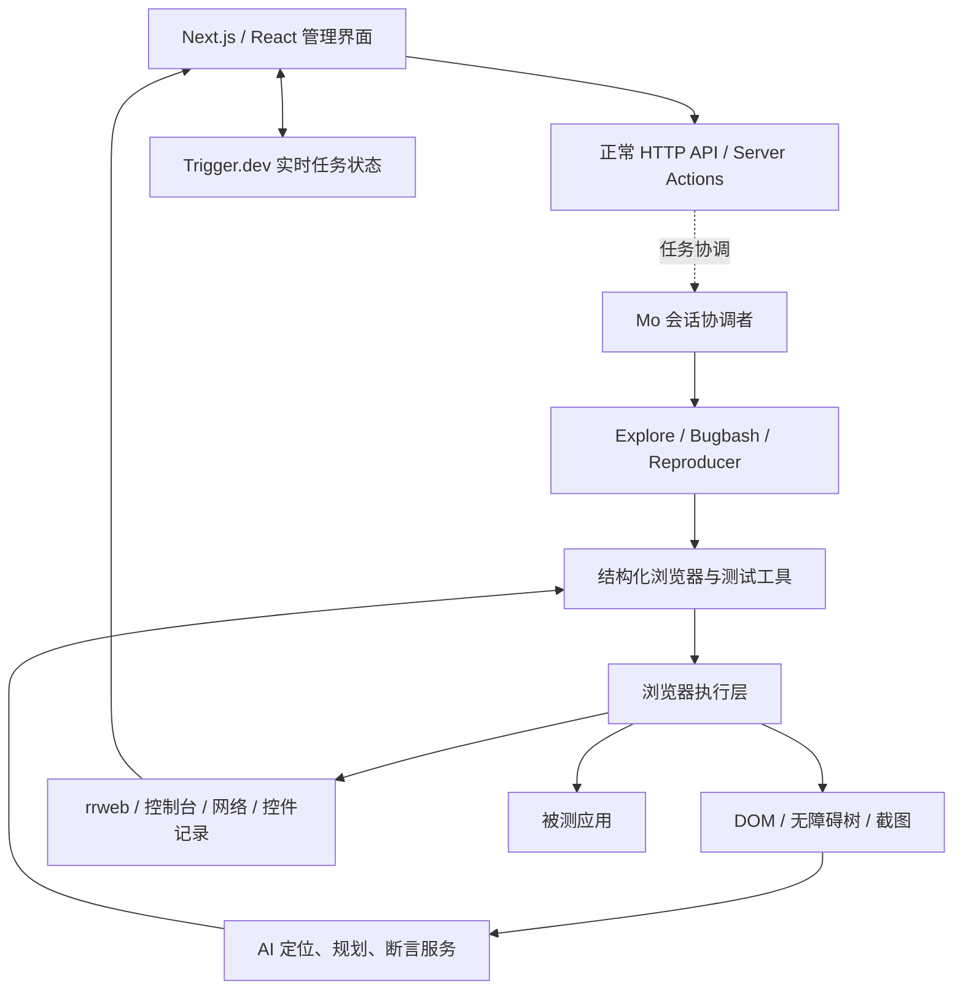

# Momentic 产品与技术拆解

核查日期：2026-10-02。通过 Ego Browser 在独立空间 64 使用已有登录态，查看产品页面、已有会话、正常页面请求及已加载的前端资源；另外静态检查官方 npm 发布包。没有启动新 QA 会话、重跑用例、提交消息或修改账号配置。

**结论：Momentic 的可见实现建立在成熟的 Web 与自动化生态上。云端管理界面使用 Next.js/React，Web 执行基础是 Playwright/CDP，AI 层使用结构化工具、模型调用和专门的测试策略，Mo 接入 Trigger.dev 实时任务能力，证据回放使用 rrweb。自建类似功能有明确路径，核心工作集中在业务测试、任务状态、定位与断言、数据隔离和可靠性。**

证据分为三类：账号页面及正常请求的实际观察；官方发布包的静态实现；结合两者作出的架构推断。发布包中的默认配置不能直接当作云端当前配置，依赖或枚举中出现的名称也不能直接当作实际服务。

## 1. 已确认和高可信的技术

| 部分 | 发现 | 证据与边界 |
| --- | --- | --- |
| 官网 momentic.ai | Astro | 官网脚本位于 `/_astro/`，组件文件带 `.astro` 构建命名；官网与 SaaS 应用是不同构建 |
| 云端应用 app.momentic.ai | Next.js，App Router/RSC、Server Actions、Turbopack 特征 | 页面含 `__next_f`，加载 Turbopack chunk，正常响应有 `x-powered-by: Next.js`，前端存在 server reference；未确认 Next.js 精确版本 |
| React | 加载的 React 包声明 `19.3.0-canary-cbb046ab-20260731` | 检查了包内实际 `version` 声明，排除了普通数字字符串匹配 |
| UI | Radix、cmdk、Lucide、CodeMirror；Tailwind 样式特征 | 已加载资源中的实现/命名及 CSS 的 `--tw-`、`--radix-`；不能确认是否使用完整 shadcn/ui 工程模板，Tailwind 版本也未确认 |
| 官方 Web CLI | Node.js ESM；包版本 `3.62.3` | npm 元数据及 `bin/cli.js`；声明 Node `^22.12.0 || >=24.0.0` |
| Web 浏览器执行 | Playwright `1.60.0`、Chromium CDP | 直接依赖与代码中的浏览器启动、持久上下文、CDP 连接、DOM/无障碍树采集 |
| 本地编辑器服务 | Express `4.22.2`、Socket.IO `4.8.3`；打包的前端静态资源 | CLI 导入及本地服务实现，发布包含编辑器和运行查看器；本次未启动本地编辑器 |
| AI 工具层 | AI SDK `7.0.113`、Zod `4.4.3`，结构化工具调用 | 官方 CLI 依赖和前端消息实现；实际历史记录含 `tool-*`、reasoning、step-start、image-reference |
| Mo 实时任务 | Trigger.dev | 页面正常访问 `api.trigger.dev/realtime/v1/runs`，前端含任务/流传输实现；不能由此确定全部服务端调度实现 |
| 被测应用回放 | rrweb；另记录截图、控制台和网络 | 执行包注入 `rrweb-record.js`，云端查看器有历史 rrweb 回放路径，实际用例详情含回放、Network、Console、Controls |
| 身份与监控 | WorkOS 集成；Sentry、PostHog、Pylon | WorkOS 前端实现/协议及官方子处理方说明；后三者也观察到实际加载资源或请求 |
| 移动端 | Appium、WebdriverIO、XCUITest、UIAutomator2、simctl、Limrun 相关集成 | `momentic-mobile@1.36.1` 的直接依赖；没有运行移动端测试 |

依据：[官网](https://momentic.ai/)、[应用](https://app.momentic.ai/)、[Web CLI 官方发布元数据](https://registry.npmjs.org/momentic/3.62.3)、[移动 CLI 官方发布元数据](https://registry.npmjs.org/momentic-mobile/1.36.1)、[官方数据与子处理方说明](https://momentic.ai/docs/account/security)。本地脱敏证据见文末。

`qa@0.19.3` 是 Mo CLI 的 Node 启动包装器，委派给对应操作系统和 CPU 的可执行文件。它与 Web 回归框架的 `momentic` CLI 是不同包；本次没有检查或运行其平台二进制，不能根据包装器判断二进制的实现语言。

## 2. 实际模型：历史记录与包默认值分开看

从账号已有会话的正常 `agent-activity` 接口，按会话状态中的角色和 conversationId 对应抽样三类记录：

| 角色 | 历史消息 metadata.modelId | 观察到的部分工具 |
| --- | --- | --- |
| `sandbox-explore` | `gpt-6-luna` | 获取环境、提出探索范围、查询预算、提交用例、报告疑似 Bug、完成探索 |
| `sandbox-bugbash` | `gpt-6-luna` | 浏览器设置、执行步骤、获取浏览器状态、搜索网络请求、记录控件、提交测试报告 |
| `sandbox-bug-reproducer` | `gpt-6-luna` | 获取浏览器状态、读取知识库、执行步骤、提交复现结果 |

这是历史执行记录的标注，能够确认抽样记录用了什么模型标识；没有直接观察服务端到模型提供商的请求。主会话协调者、定位/断言子模型、其他会话及新任务的实际配置，仍不能据此确定。

另一方面，`momentic@3.62.3` 的打包代码中，explorer、bugbasher、test-builder 路径引用 `gpt-5.6-sol` 默认常量，reasoning effort 为 `high`，并存在 OpenAI/Azure 的提供方回退配置。**这些是发布包中的路径和默认值，不证明当前云端 Mo 完全复用同一套实现，也不覆盖账号历史记录里的配置。**

仅列出包内所有模型字符串没有判断价值：部分名称来自通用模型 SDK、遥测代码或无关字符串。具体模型应优先按对应任务的执行元数据判断。

## 3. 产品实际上由哪些模块组成

### Mo 工作区

入口包括新会话、历史会话、Schedules、Workspace、Environments、Knowledge base。会话界面由对话、Agent 列表、测试用例、Bug 列表和证据查看器组成。

本账号可以查看已有完整会话，配有一个测试环境；仓库、知识库及定时任务当前为空。空状态页面能证明入口和交互设计，不能据此声称对应集成已验证成功。

### 仓库回归平台

通过工作区菜单的 Back to app，进入另一套导航：

| 分区 | 已观察到的模块 | 作用 |
| --- | --- | --- |
| Repository | Knowledge、Assets、Pull requests | 应用知识、移动构建、测试修复与代码协作 |
| Execution | Run groups、Runs、Quarantine、Rules | 运行组织、结果、易波动测试隔离、规则 |
| Analytics | Health、Failures、Performance、Agents | 测试健康、失败、性能、AI 使用情况 |
| Settings | Classification、Triage、邮件/SMS、Integrations、Notifications、成员、API keys、SSO、Usage/Billing | 失败处理、修复交付、协作、身份与计费 |

这个账号的仓库测试初始化尚未完成，移动 Assets 也为空，因此回归执行部分主要依据发布包与官方文档，不能当作已在账号里运行验证过。

### 两套系统的共同基础

业务环境、知识、版本、测试数据、认证状态、浏览器执行和运行证据可共同支撑回归与探索，但它们的输入不同：回归运行审查过的用例；Mo 根据说明生成、执行和复现检查。

Classification 页面将失败分类为 Application change、Bug、Test authorship、Test setup、Infra、Momentic issue、Other，并配置 Heal/Fail/Warn。Triage 页面管理修复后的交付和 GitHub 审查流程。这里包含测试治理与协作成本，不能只按“模型找到按钮”估算整个产品。

## 4. 已有会话暴露出的数据模型

正常状态接口返回以下实体集合：

`agents`、`testCases`、`bugs`、`controls`、`verdicts`、`triage`。

它还返回汇总、会话状态和活动任务数量。Agent 有角色、conversationId、状态、任务说明、预算、耗时、最近工具和结果等字段；工具消息有文本、推理摘要、调用及图像引用等分块。

本次所读会话的产品统计如下，属于 Momentic 的报告结果，没有重新测试目标系统：

| 项目 | 记录值 |
| --- | ---: |
| 测试用例 | 587 |
| Passed | 476 |
| Issues found | 46 |
| Blocked | 65 |
| Bug 报告 | 33，均待审查 |
| Agent 记录 | 1,067 |
| Explore 记录 | 79 |
| Bugbash 记录 | 899 |
| Bug reproducer 记录 | 89 |
| 控件记录 | 12,373 |
| Verdict 记录 | 752 |

**界面的 `522/587 verified` 等于 476 passed 加 46 issues found，不能解释为 522 条用例通过。** 一条用例可能有多次结果，Agent 记录数量也不等于同时运行的 Worker 数量；不能由这些统计反推出并发规模、准确率或缺陷检出率。

这提示自建的数据设计至少需要区分用例、执行记录、执行结论、疑似问题、复现结果和人工处理状态，保留历史和关联，而不是每条用例只保存一个布尔值。

## 5. Web 执行链路的解构

结合发布包、页面请求和实际执行日志，能够重建以下结构。虚线连接表示服务端内部关联的推断；具体 Worker 部署方式没有直接证据。

### 浏览器层

官方 Web CLI 直接使用 Playwright 启动 Chromium、创建普通或持久浏览器上下文，也支持远端连接和 `connectOverCDP`。通过 CDP 采集 DOMSnapshot 和完整无障碍树，并读取布局、可操作性和坐标；截图作为另一种观察输入。

实际历史用例里可以看到 `AUTH_LOAD`、`NAVIGATE`、`WAIT`、`REFRESH`、`AI_ASSERTION` 等步骤，以及网络检查和认证状态恢复。这里查看的是既有日志，没有执行这些指令。

### AI 层

发布包中存在不同的远端 API 路径，分别处理 locate-element、assertion、visual-assertion、text-extraction、smart-waiting、failure-recovery、result-classification 和 AI action 的下一步决策。

页面过大时，代码先构建树、分块、选择与目标相关的块再传入后续判断，存在 AI 排序和检索排序路径；返回结果由 Zod/Schema 解析，并交给浏览器执行。定位需要考虑缓存、记忆、版本和 effort 等上下文。

这些路径已在包中确认，本次没有主动调用推理接口，也没有测量其内部算法质量。实际云端模型路由、提示和检索实现仍在服务端。

### 工具层

实际角色记录显示不同工具集合：探索可提交用例和疑似问题；执行角色可操作浏览器、检查网络并报告结果；复现角色输出独立复现结论。工具参数和结果是一层明确协议，模型不需要直接自由生成任意浏览器控制代码。

### 证据层

发布包会注入 rrweb 记录被测页面的变化；查看器支持历史回放，并关联步骤、截图、网络、控制台和控件信息。移动回放有另一条媒体/片段路径。Web 回放不能仅凭显示了浏览器画面就认定为远程桌面或 WebRTC 视频。

## 6. 本地私有化时如何替换

| Momentic 的可见部分 | 自建建议 |
| --- | --- |
| Next.js/React 管理面 | 同类 Web 技术即可，先有用例、执行、结果三个主要页面 |
| Playwright/CDP 执行 | 直接复用开源基础；为不同运行隔离浏览器上下文、账号与数据 |
| Trigger.dev 等云任务能力 | 先实现本地任务状态、队列和 Worker；需要持久恢复和大规模并发时再扩展 |
| 托管模型与 AI 服务 | 内部模型服务加适配层；验证视觉、工具调用、结构化输出、上下文管理与断言 |
| rrweb 和运行证据 | 本地采集和存储，关联用例、步骤、任务、复现和人工审查 |
| WorkOS 等外部身份服务 | 按现有企业身份系统接入；单机验证阶段可先简化 |
| 外部监控、客服、计费 | 内部版按实际需要取舍，优先保留定位失败所需的日志与指标 |

之前建议的 Playwright + Midscene 仍可用于快速验证类似体验。不过，如果目标是更接近 Momentic 的 Web 定位与缓存机制，技术验证应比较两条路线：

1. Playwright + Midscene：复用视觉操作、断言和报告，减少底层开发。
2. Playwright + DOM/无障碍树驱动的定位层：优先确定性选择器，AI 解析目标并校验缓存；可以参考 Stagehand 的开源实现，但其 v4 托管缓存不能直接作为本地缓存使用。

不需要从零训练基础模型。完全内网部署的重点是适配实际模型能力、把所有数据和依赖留在边界内，并证明业务测试结果可靠。对齐功能目标即可，不必逐个复刻厂商使用的外部服务。

首期仍建议选择一个内部 Web 系统，验证回归与少量受控探索。多角色探索会扩大任务数、上下文、数据冲突和资源消耗，预算、停止条件、去重、复现和清理应作为调度能力一并设计。

## 7. 不能从本次探测确认的部分

| 项目 | 当前结论 |
| --- | --- |
| 后端数据库与 ORM | 未确认。Prisma 字符串来自语法高亮；Postgres/Redis 字符串部分来自 Trigger.dev SDK；CLI 的 pg 依赖也不能证明平台数据库 |
| 云端 Worker 的语言与框架 | Node/TypeScript 生态证据较强，但云端全部服务的实现语言未确认 |
| 具体容器/VM 隔离方案 | 未确认，不能声称使用 Docker、Kubernetes、E2B 或 Modal |
| 本次 Mo 的浏览器基础设施供应商 | 未确认。包中 Azure、Kernel、Browserbase、Self-hosted 枚举仅证明有对应协议/候选路径 |
| 对象存储实际供应商 | 有对象/媒体/设备证据接口及 S3 命名路径，但无法确认全部存储供应商 |
| 云平台具体部署产品 | 官方说明列出 Google Cloud，正常请求也有 Google 转发特征；不能进一步认定 Cloud Run、GKE 等产品 |
| 当前所有 AI 模型与路由 | 只确认三类历史记录的模型标识和公开包的默认值；定位/断言、主协调者和新任务配置仍未确认 |
| 性能、稳定性、准确率 | 本次只读分析，没有做新的执行或基准测试 |

## 8. 保留证据与实际操作范围

保留目录：[evidence/2026-10-02-space64](/Users/dcp/Documents/公司/momentic/evidence/2026-10-02-space64)。主要文件：

- [前端资源索引与哈希](/Users/dcp/Documents/公司/momentic/evidence/2026-10-02-space64/client-assets-index.json)：74 个已加载的 Next.js 资源、关键词候选与误判说明。
- [正常请求记录](/Users/dcp/Documents/公司/momentic/evidence/2026-10-02-space64/network-p1.json)：接口路径、方法、状态、查询参数名称；会话 UUID 脱敏。
- [发布包与引擎摘要](/Users/dcp/Documents/公司/momentic/evidence/2026-10-02-space64/cli-engine-summary.json)：运行基础、API 路径、包默认值和源码哈希。
- [核实后的模型抽样](/Users/dcp/Documents/公司/momentic/evidence/2026-10-02-space64/verified-agent-model-samples.json)：按真实角色与 conversationId 对应的三类记录。
- [会话数据结构](/Users/dcp/Documents/公司/momentic/evidence/2026-10-02-space64/session-api-structure.json)：字段名称和类型，未保存消息正文或令牌值。
- [会话统计](/Users/dcp/Documents/公司/momentic/evidence/2026-10-02-space64/session-summary.json)：账号已有报告的汇总。
- [前端与官网摘要](/Users/dcp/Documents/公司/momentic/evidence/2026-10-02-space64/frontend-runtime-summary.json)：分别核对 Astro 官网与 SaaS 应用。
- [Web CLI 元数据](/Users/dcp/Documents/公司/momentic/evidence/2026-10-02-space64/cli-package-metadata.json)、[移动 CLI 元数据](/Users/dcp/Documents/公司/momentic/evidence/2026-10-02-space64/momentic-mobile-package-metadata.json)、[Mo CLI 元数据](/Users/dcp/Documents/公司/momentic/evidence/2026-10-02-space64/qa-package-metadata.json)。

正常读取限定在账号可见的页面、已有会话和浏览器实际使用的 GET 接口，没有猜测其他用户资源或访问管理权限之外的内容。证据没有保存 Cookie、Authorization、实际 token 或用户输入的认证内容。

静态包只下载和解析，没有安装或执行。原始 bundle、包归档等临时材料在交付前清理；仅保留必要的技术摘要、哈希和脱敏证据。浏览器任务空间在完成时关闭，账号原有数据不作清理。
