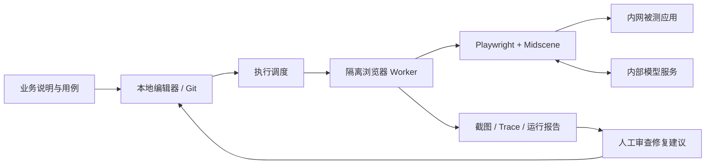

# Momentic 私有化可行性分析

调研日期：2026-10-02。第一轮调研时工作目录为空，本次分析对象是 Momentic 产品及其公开文档，没有可审查的本地项目源码。后续账号页面、执行记录和官方发布包的技术核查见 [Momentic 产品与技术拆解](/Users/dcp/Documents/公司/momentic/Momentic-产品与技术拆解.md)。

**判断：自建面向内部 Web 系统的 AI 回归测试工具可行；完全内网运行也有现成技术路径。建议先复用 Playwright 和 Midscene，验证一个业务系统，再开发管理界面。达到 Momentic 全平台、自动探索和长期维护的产品成熟度，需要持续投入，不能用一个演示原型的效果推断。**

以下将已核实事实、方案建议和工程估算分开。模型效果、硬件容量和实际业务适配尚未实测。

## 1. Momentic 提供什么

Momentic 当前有两条主要产品线。

| 产品线 | 已核实的能力 | 自建时对应的目标 |
| --- | --- | --- |
| 仓库内回归测试 | YAML 用例混合固定步骤、AI 动作、可复用模块；本机或 CI 执行 | 首期优先：把已有业务用例变成可重复执行的测试 |
| Mo 探索测试 | 从应用地址和测试说明出发，规划、执行并报告问题；功能缺陷由独立执行角色复现 | 后续扩展：在明确范围内发现疑似缺陷，再独立验证 |

回归框架用专门的 AI 能力处理元素定位、语义断言、视觉断言、信息提取和失败恢复。成功定位及部分 AI 动作可以缓存，后续先回放，失效后重新解析。AI 断言与查询结果不能简单沿用上次结论。[工作机制](https://momentic.ai/docs/get-started/how-momentic-works)、[AI Agents](https://momentic.ai/docs/ai/agents)、[步骤缓存](https://momentic.ai/docs/reliability/step-cache)

它还有本地可视化编辑器，提供步骤编辑、运行与调试。Web 面向 Chromium；iOS 使用模拟器，Android 使用模拟器。本次阅读的官方文档明确表示不支持物理设备。[本地编辑器](https://momentic.ai/docs/local-app)、[平台说明](https://momentic.ai/docs)

Mo 将规划、探索、执行及复现分成不同角色，功能缺陷需要在独立会话中再次复现；探索得到的报告和长期回归用例是不同资产。首期自建应先解决回归，探索模式可在后续使用同一执行与证据基础设施。[Mo 文档](https://momentic.ai/docs/mo)

## 2. 本地执行与完整私有化的边界

**官方企业页面明确说明：目前不提供完整 on-premise 安装，控制服务运行在 Momentic 云端，测试执行可位于客户内网。** 因此，安装它的 npm 包或启动本地编辑器，并不能直接获得完全独立的私有化平台。[企业部署 FAQ](https://momentic.ai/enterprise)

AI 功能会向托管模型提供商发送提示词、页面上下文、截图、HTML/无障碍快照等输入。运行结果是否上传，是另一项设置；仅关闭结果上传不能据此证明 AI 输入留在内网。模型提供商的数据保留政策与 Momentic 自身的日志、AI trace 保留政策也应分别判断。[AI 数据使用与保留](https://momentic.ai/docs/account/ai-data-use)

| 部署目标 | 自建可行性判断 | 主要限制 |
| --- | --- | --- |
| 浏览器、管理服务、报告在内网，使用外部模型 API | 高，适合对模型效果做早期对照 | 页面及截图可能出网，需要业务允许 |
| 浏览器、管理服务、模型、缓存、证据都在内网 | 技术路径明确，需先验证实际质量和吞吐 | 模型适配、GPU/内存、视觉定位、长流程稳定性 |
| 完全断网且希望自动探索任意业务、达到云平台同等质量 | 范围过大，现阶段无法给出可靠达成承诺 | 测试预期来源、模型能力、长期评测、平台运维 |

完全内网模式要求所有模型职责都使用内部服务，包括规划、定位、断言、提取以及可能使用的知识检索。还要核查日志/遥测、自动更新、模型下载、依赖包、外部字体及目标系统自身的外部资源。以禁止外部访问后的端到端执行和网络记录验收，不能只检查一个模型 Base URL。

## 3. 可复用的基础

| 组件 | 已核实事实 | 建议用途及限制 |
| --- | --- | --- |
| Playwright | Apache-2.0；提供浏览器自动化、语义定位与自动等待 | 执行基础。优先使用 role、label、test id 等稳定定位 |
| Midscene | MIT；提供视觉 UI 操作、断言、Playwright 集成、本地缓存和报告 | 优先评估的 AI 层；中文业务页面的实际效果需验证 |
| Midscene Test | YAML 用例加 TypeScript 自定义节点；有生命周期和并发机制 | 与目标较接近，但目前为 Beta，协议和 API 仍在演进 |
| Stagehand | MIT；支持本地浏览器和自定义 LLM 回调 | 语义定位/提取的候选；v4 文档中的托管缓存依赖 Browserbase，本地需要另做缓存 |
| 可本地部署的视觉模型 | 例如 Qwen3.5-9B 有视觉输入、公开权重，并有 vLLM 等运行路径 | 可作为低成本验证候选，业务效果及 Midscene 端到端兼容性仍须实测 |

依据：[Playwright 定位文档](https://playwright.dev/docs/locators)、[Playwright 许可证](https://github.com/microsoft/playwright/blob/main/LICENSE)、[Midscene 官网](https://midscenejs.com/zh/)、[Midscene 许可证](https://github.com/web-infra-dev/midscene/blob/main/LICENSE)、[Midscene Test](https://midscenejs.com/zh/midscene-test/overview)、[Midscene 缓存](https://midscenejs.com/zh/caching.html)、[Stagehand](https://github.com/browserbase/stagehand)、[Stagehand 自定义模型](https://docs.stagehand.dev/v4/configuration/models#custom-models)、[Stagehand 缓存限制](https://docs.stagehand.dev/v4/best-practices/caching)、[Qwen3.5-9B 模型卡](https://huggingface.co/Qwen/Qwen3.5-9B)。

**方案建议：先做 Playwright + Midscene 的业务验证，不从零开发视觉定位器，也不在初期训练自己的模型。** 若 Midscene Test 的 Beta 接口影响稳定性，可以先用 Playwright Test + Midscene SDK，随后再增加稳定的声明式用例层。

Midscene 自带本地缓存，但 DOM/XPath 缓存对 canvas、部分 iframe、closed Shadow DOM 等有局限。它能在缓存失效时重新调用模型；缓存的价值应以实际命中率和运行时延衡量。[缓存文档](https://midscenejs.com/zh/caching.html)

开源组件的许可证与具体模型权重许可证分别确认，固定依赖版本并保留相关声明。不能假设公开 npm 包就包含 Momentic 可独立部署的控制服务，也不以复制其私有实现为实施路径。

## 4. 建议的系统结构

先做单机可用版本，之后再扩展为内部多人平台。

首期用文件保存用例和报告，CLI 执行；不必立即引入分布式队列。多人共享后再增加管理 API、数据库、任务队列、对象存储、权限和审计。先有可靠测试执行，再做用例编辑、执行列表与结果回放三个主要界面。

执行策略采用分层设计：

1. 常规控件优先确定性定位和操作；金额、权限、状态等关键结果优先使用明确断言，必要时增加接口校验。
2. 常规定位无法可靠处理的控件、视觉检查、复杂交互使用 AI。
3. 每次操作后检查状态；缓存仅在目标仍匹配时使用，失败或状态不明时停止并保留证据。
4. 定位修复保持测试意图，展示修复前后目标和证据；修改预期结果或业务路径形成可审查的建议。
5. 疑似缺陷由新的浏览器上下文和等价独立测试数据复现，结果明确标为已验证、疑似或受阻。

可对接已有禅道用例、内部测试数据接口或 CI，但首期选择一种输入方式即可。Bug 草稿应包含必要步骤、实际结果、期望结果及证据；提交、激活或关闭前展示具体内容或目标并等待确认，与当前工作约定保持一致。

## 5. 真正影响成败的部分

**测试预期。** AI 可以寻找控件和执行动作，却不能凭空知道企业业务规则。保存成功不等于金额正确，列表有数据不等于权限隔离正确。业务规则和验收条件必须来自用例、需求或接口契约。

**完整流程稳定性。** 单步点击成功的演示不足以证明可用于 CI。用简化的独立概率举例，30 个步骤每步成功率为 99%，整条流程成功率约为 `0.99^30 ≈ 74%`。真实步骤不完全独立，但这个估算说明了为什么等待、会话、数据隔离、缓存和错误恢复必须一起设计。

**自动修复掩盖缺陷。** 只修复控件定位与修改测试期待是不同风险。禁止为了让测试通过而自动删除断言、降低金额/权限检查，或将本应失败的业务错误改为成功。首期 CI 按执行与断言结果判定；AI 分类用于辅助解释。

**业务数据和账号冲突。** 独立浏览器仍可能共用后端数据。每次运行生成唯一标识，默认创建自己的测试记录；修改既有数据前记录基线，结束只清理本次临时数据并回查。清理失败也应出现在报告中。

**本地模型。** 接口可调用、视觉定位准确、结构化输出有效和长流程可靠是四项不同验证。较小模型可以验证部署路径，但可能需要更强模型处理复杂页面和语义断言；按测得效果决定模型分工。

**硬件和吞吐。** 不依据模型参数量直接承诺可支持多少并发。权重、量化、截图分辨率、上下文长度、缓存及并发请求都影响容量。应测 GPU/内存峰值、单次请求 P50/P95、整条用例耗时和每次运行资源成本，再确定采购规格。个人电脑适合原型，持续多人 CI 需要评估独立执行与推理服务。

## 6. 投入估算与首期范围

以下是工程经验估算，按已有全栈开发和自动化经验、复用开源组件、先覆盖一个内部 Web 系统计算。人员是主要投入人员，时间是从启动到对应阶段的累计日历时间；不包含需求等待、采购、跨团队集成和正式上线审批。

| 阶段 | 主要交付 | 人员假设 | 累计时间估算 |
| --- | --- | --- | --- |
| 技术验证 | 代表性用例、稳定性/成本记录、模型比较、证据回放 | 1–2 名工程师，业务测试人员参与 | 2–3 周 |
| 可用 MVP | 用例管理、手动执行、报告、内网部署、有限缓存 | 2 名工程师，测试人员持续参与 | 6–10 周 |
| 内部持续使用平台 | CI、并发隔离、版本、权限、数据治理与日常维护 | 3 名工程师，加测试及运维支持 | 3–6 个月 |
| 多端与自主探索 | 移动端执行、规划/复现、知识和覆盖分析 | 4–6 名工程师，加专项测试及运维 | 6–12 个月以上，需重新估算范围 |

完全断网且缺少现成模型服务时，先把部署和质量验证加入技术验证阶段，后续排期依据实测重估；不能简单承诺上述周期不变。对外销售的产品还需要升级交付、跨客户兼容、服务保障等持续投入。

**首期范围建议：一个 Web 系统、一个主要浏览器、明确的已有业务用例、人工确认修复建议。** 包含登录、查询、表单、列表、弹窗、关键断言、报告和清理；移动端、自主覆盖所有需求以及大规模分布式调度暂列后续阶段。

经济性取决于隐私要求和长期定制需求。官方当前提供免费额度，付费自助方案标为每月 125 美元加额外用量；页面的约 1,000 次运行是估算，费用还受步骤和功能使用影响。[官方价格](https://momentic.ai/pricing)

若目标只是降低订阅费，开发与维护人力可能远高于购买费用。若需要页面数据全程留在内网、国产/自有模型、内部数据准备和禅道流程，自建的价值更明确。

## 7. 用技术验证决定是否继续

选择 20–30 条覆盖实际难点的用例：登录、多列表、复杂表单、弹窗、异步加载、iframe 或 canvas（若业务有）、下载以及权限/金额/状态检查。测试系统与数据应可恢复，并记录应用版本、模型版本、提示配置和执行环境。

比较确定性的 Playwright 基线、使用 AI 的方案与完全内网模型方案。只有业务允许模型输入出网时才增加外部模型对照。

每条健康用例先连续运行 10 次，不把重试后的通过混入首次通过率。由业务测试人员核对结果；小样本达标仅是继续试点的依据。

| 验证项目 | 建议的继续条件，属于目标而非已达成绩 |
| --- | --- |
| 健康流程稳定性 | 首次完整通过率至少 95%，按用例拆分并定位每类失败；作为 CI 门禁前继续压低误报 |
| 缺陷检测 | 在可恢复的验证环境中预设缺陷，关键错误不出现“错误通过”；覆盖不足时继续扩大样本 |
| UI 变化适应 | 对标签、位置、结构的变化，记录是否找到同一语义目标、是否仍保留原断言 |
| 缓存收益 | 分开测冷启动、稳定页面回放、变化后的回退；比较时延、调用数与维护量 |
| 私有化 | 禁止外部访问后全流程完成，并核对推理、日志和运行证据去向 |
| 投入价值 | 记录新用例编写、失败排查和 UI 改动后的维护时间，与现有方式比较 |

如果失败主要来自可以修复的页面等待、数据或生命周期管理问题，可继续实施。如果本地模型对核心页面持续误判、关键缺陷出现错误通过、成本或时延明显超过业务预算，应先调整模型/用例边界或保留更多确定性步骤，再决定是否扩展平台。

## 8. 本次核查范围

已核查：本地目录状态、Momentic 官方部署与数据文档、主要测试机制、公开价格、Midscene/Stagehand/Playwright 的官方文档与许可证，以及一个可本地部署视觉模型的官方模型卡。

尚未验证：你们系统上的实际成功率、中文复杂页面效果、本地模型与 SDK 的完整兼容性、完全断网运行、并发容量和 GPU 规格。没有运行业务测试或修改测试数据；本文不构成已完成的原型或性能验收。

研究使用的浏览器空间与临时下载文本在完成后清理；本文及来源索引作为交付物保留。实施前最影响范围的三个输入是：是否必须完全断网、首期覆盖 Web 还是移动端、以及可投入人员和现有模型/GPU 基础。
