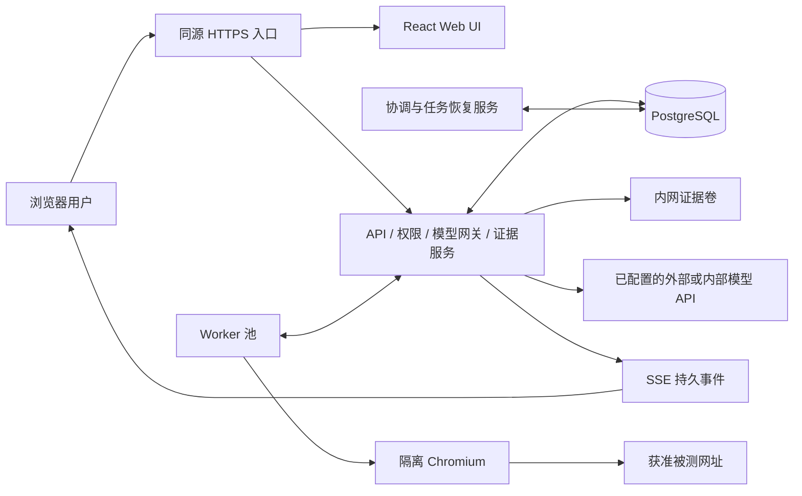

# 技术设计说明书

版本 1.0；目标为多用户内网 Linux 平台。实现选型属于 LocalQA，不能当作 Momentic 服务端实情。

## 1. 部署和模块架构



生产默认单 Linux 主机 Compose，包含入口、web、api、orchestrator、worker、postgres。Worker 可增加副本，但同一运行和不同角色共同受配额约束。数据库与证据卷必须持久化；浏览器 scratch 为可丢弃材料。初期不引入 Kubernetes、外部任务 SaaS 或外部账号服务。

| 部分 | 实现基线 |
| --- | --- |
| 语言和运行时 | TypeScript strict，Node 24 LTS，pnpm workspace |
| 前端 | React 19 稳定发行版、Vite、路由、Radix 组件；状态来自 API/SSE |
| API | Node 内置 `node:http` + 自有 Router（`apps/api/src/router.ts`），契约 JSON Schema 由 Ajv 校验，统一错误和权限；设计期候选 Fastify 5/Zod 4 未采用 |
| 数据访问 | PostgreSQL 18、pg、显式 SQL migration 和 repository；SQL 映射不直接暴露给 UI |
| 任务 | PostgreSQL jobs、条件更新、租约、心跳、fencing；NOTIFY + 轮询唤醒 |
| 执行 | Playwright 基线 1.63.0 与对应 `v1.63.0-noble` 镜像，包/浏览器版本一致 |
| 模型 | 自有 ModelPort，自研 OpenAI 兼容与 Anthropic 适配器（`packages/model-gateway/src`）；不同提供方参数在 adapter 内处理；设计期候选 AI SDK 7 未采用 |
| 证据 | 截图、步骤事件、console/network、Playwright trace、rrweb；ArtifactStore 抽象 |

确切 patch、镜像 digest、系统字体和模型兼容表由 M0 固定到 lockfile/部署清单。不能仅因为 Momentic 依赖某个包就直接采用其全部默认配置。

## 2. 代码边界与职责

当前实际目录（相对设计期建议：编排器实现为 `packages/orchestrator`，另有命令行 `apps/cli`）：

```text
apps/web                 页面、交互、生成的 API client、SSE 状态投影
apps/api                 HTTP、RBAC、配置、运行命令、内部服务入口
apps/worker              task runner、浏览器生命周期、取消和结果提交
apps/cli                 CI/命令行入口：API Key 发起运行、等待并按报告给出退出码
packages/contracts      从 docs/contracts 生成/映射的类型、验证器、错误码
packages/domain         状态机、预算、oracle、去重、统计与策略
packages/browser        Playwright adapter、snapshot、目标解析、记录器
packages/agents         planner/explorer/executor/reproducer，版本化提示模板
packages/orchestrator   阶段推进、配额、租约与任务恢复、认证执行、回归编译、最终报告
packages/model-gateway  provider adapters、能力表、用量、超时、脱敏
packages/storage        repository、migration、ArtifactStore、SecretVault
packages/test-fixture   受控测试网站、种子数据、已知故障与审计查询
deploy                  Compose、镜像、代理、备份、运维说明
```

UI 不直接连接模型、数据库、Worker 或裸证据目录。Worker 不直接解密全局密钥，也不读取其他项目数据。租约领取及权威状态写入由内部 API/协调服务执行；浏览器操作与模型输出不能绕过领域策略。

当前实现偏差：Worker 仍直接持有数据库连接与 KEK，并使用进程内 Coordinator，尚未切换为内部 HTTP 身份边界（见 `deploy/README.md` 开头说明）；生产上线前须完成该隔离改造。

## 3. 运行状态、阶段和角色

`Run.status`：draft、queued、running、awaiting_input、cancelling、completed、cancelled、failed。

`Run.phase`：preflight、auth、explore、plan、execute、reproduce、finalize。

典型链路：queued→running/preflight→auth→explore→plan→execute→reproduce→finalize→completed。阶段可以因无认证、无问题而跳过。awaiting_input 保存 previousPhase 和具体 InputRequest；到期恢复为受阻/部分结果，而非无限等待。P0 不提供任意浏览器检查点的“暂停后原样恢复”。

角色是受限任务，而不是允许自由启动进程的通用编程代理：

| 角色 | 输入 | 允许产出/职责 |
| --- | --- | --- |
| coordinator | URL、环境/知识/策略快照、预算 | 推进阶段、汇总，不直接任意点击页面 |
| explorer | 获准入口、图谱、剩余预算 | 非提交式探索、控件记录、候选流程；不确认 Bug |
| planner | 探索结果和可信预期 | 冻结用例版本、确定 criterion ID 和来源；由 coordinator 调用 |
| executor | 一条不可变用例、认证配置引用 | 通过工具执行，产生一次 attempt 与 verdict |
| reproducer | 疑似问题、相同 criteria、等价准备 | 全新 context 复现；不能削弱原预期来确认或消除问题 |
| finalizer | 事实数据、证据状态、清理账本 | 确定性计算统计、生成报告、列出缺口；模型摘要为可选附加 |

终态 completed 表示调度结束，不表示测试通过。`completion` 为 complete/partial/none；`terminationReason` 独立记录 normal/budget_limit/input_timeout/user_cancel/worker_failure/model_failure/setup_failure。清理失败和证据缺失作为报告警告及 cleanupStatus 记录，不能隐藏。

complete 表示正常结束且计划已全部尝试并收尾，不等于全部条件判定成功；预算/取消/等待超限造成未完成为 partial；尚未尝试或入口完全不可达为 none。

仅当整个运行没有可继续任务、必须等人输入时置 awaiting_input；某个子任务等待而其他任务仍执行时，Run 保持 running，等待的 InputRequest 单独展示。active 预算不能因一个子任务等待而停止统计其他角色工作。

## 4. 从 URL 到用例的流程

1. 解析 URL，拒绝 userinfo、非 HTTP(S) 与受保护地址；保留有效 path/query。含敏感 query 的原始值加密保存，DTO/日志使用脱敏 URL。
2. 冻结项目、环境、知识、模型、认证和策略版本，确定允许 origins、初始路径及配额。配置被删除/撤销时不能退回匿名无限范围。
3. 预检 DNS/连接/TLS/页面内容和模型能力；区分认证、基础设施错误与功能异常。
4. Explorer 在 maxPages/maxDepth/maxActions 内建立页面/控件图谱。URL 与结构指纹去重，避免返回/分页循环；任何新 origin 均重新校验。
5. Planner 生成至多 maxCases 条用例，并检查每条预期来源、策略、可执行性与去重条件。
6. 冻结计划；创建 executor 任务，分别从已知前提和获准认证开始。跨用例共享业务写入状态不是默认机制。
7. 失败区分 issue_found/blocked/inconclusive。功能疑似问题最多触发 maxReproductions 次独立复现，其余保持 suspected。
8. Finalizer 聚合事实、执行清理、生成报告。所有没有执行到的计划和未覆盖控件明确列出。

预期来源：generic_smoke、user_spec、project_knowledge、saved_case、inferred。generic_smoke 可以验证入口、内容、导航等技术契约；inferred 不能独立支持“某业务规则有 Bug”的 confirmed 结论。user_spec/knowledge 也必须注明版本和具体依据，不能把不相关文本当规则。

## 5. 浏览器工具与定位

### 5.1 受控工具链

调用按 `ToolCall→Schema→角色许可→运行上下文→范围/风险→预算预约→ActionIntent→浏览器→新 snapshot→结果提交` 执行。

模型只能提出工具名和参数。runId、projectId、taskId、租约、用户身份、审批和有效配置由运行时绑定，不能信任模型填的 ID。禁止暴露任意 evaluate、shell、服务器文件读写和任意 HTTP 请求工具；内部固定 JS 可用于 snapshot/DOM 检查，但不能执行页面提供的代码文本。

SDK 如果自动执行工具，其 execute 函数只能进入统一 Dispatcher；不可直接调用 Playwright。无 native tool-calling 的模型可用严格 JSON 决策协议，但输出仍经相同验证，最多一次格式修复请求。

### 5.2 Snapshot

包含 snapshotId、pageId、frameId、URL/display URL、时间、版本、viewport、可见/可操作节点、角色/名称/文本、布局和受限 attributes、脱敏 screenshot 引用、近期网络/console 摘要。

先用 Playwright 公开接口获取语义信息，必要时用 CDP DOMSnapshot/AX 补充；CDP 放在 adapter 内并建立兼容测试，不让业务层依赖内部对象形状。剔除隐藏输入值、cookie、storage、认证 query 和无关脚本。多 frame 分别标识；不可访问的 frame 明确记录。

目标优先顺序为 test id/role/label 等稳定契约→唯一文本和结构→模型选择的 node→必要的视觉定位。操作前重新验证唯一性、可见性、可操作性和当前版本。过期 snapshot、多个候选、目标语义变化均拒绝操作并观察；不靠模型自报 confidence 代替验证。

### 5.3 等待和恢复

导航等待 DOMContentLoaded，再按页面状态检查；不能要求所有站点 networkidle。默认工具 15 秒、导航 30 秒，均受运行剩余时间限制。最多两次非破坏性定位/等待恢复；相同动作与页面指纹重复三次停止该用例。

恢复只处理等待、瞬时遮挡和定位变化，保留原验收条件。服务不可达、认证失败、数据缺失、模型错误、CAPTCHA 不循环重试。Playwright 的内部重试也纳入 active 时间。

### 5.4 策略和网络

P0 `non_submitting` 允许观察、获准导航、明确安全的 tab/展开/分页等非提交交互。表单提交、删除、发送消息、修改账号配置及未知副作用动作默认跳过并记录。

不能简单阻断全部 POST：SPA 可能用 POST 读取数据。范围在工具和请求层校验，管理员可配置已知写入/自动保存/危险 GET 路径。私网 URL 是需求，不能一律按 SSRF 禁止；平台控制面、数据库、模型密钥服务、link-local 元数据地址和非获准 origin 必须限制。重定向、popup、下载和 WS 也需要范围校验。

浏览器请求拦截不是完整主机网络隔离。需要更严格出网边界时增加执行网络代理/防火墙并验收覆盖，不能仅因设置 allowedOrigins 就宣称容器绝不出网。P0 对任意网站无副作用的承诺限制见 SRS。

## 6. 模型网关、上下文和判断

`ModelPort` 至少提供 capabilityProbe、generateDecision、evaluateCriterion；输入是规范化消息、获准图片引用、工具 schemas、输出 schema、超时和预算。adapter 独自映射各家 model 名、token 参数、response_format、tool 格式和 usage，不把一家提供方的参数通用于所有模型。

每次请求记录 profile/version、modelId、adapterVersion、promptVersion、角色、耗时、请求结果和 reported/estimated 用量。禁止悄悄切换到未配置的外部服务；fallback 必须来自管理员批准的列表并在报告记录。图片不受支持时，视觉验收不得伪装为文本验收。

页面/附件/console/旧缓存属于观察材料，不成为动作授权或系统指令。上下文按 URL/frame/控件相关性裁剪，保留验收依据、实际观察和近期动作。单请求默认上限 12,000 输入 tokens；输出上限按模型配置（`maxOutputTokens`，256–32,000，未设置时 4,000），决策、断言和能力探测都用这个值，调用方只能请求更小的值，不能放大。先思考再作答的模型（如 MoreSec DeepSeek）会把推理也计入输出，要留足；不思考的模型会提前结束，上限只影响预算预约，用完后按实际用量核销。超大页面分块，重要信息无法保留时标为不确定。长期摘要注明对应观察版本，不用摘要替代当前证据。

关键数据与权限预期优先确定性校验。AI semantic/visual 判断须给 criterionId、结论、观察引用和简短依据；运行时核对引用属于本次/当前页面，不能接受模型捏造的证据 ID。无可引用依据时判 inconclusive。

按只给 URL 的场景，可以生成通用可用性检查；无法从 URL 推出审批权限、金额或复杂业务的正确规则。隐含推断与明确规则分开，见证据/结果协议。

## 7. 认证与敏感数据

SecretVault 用随机 nonce 的 AES-256-GCM 加密，记录 keyVersion；KEK 通过受保护挂载提供，不存数据库和镜像。API 返回 secret 名称和元数据，不返回原值。备份密钥另存，恢复和轮换实测。

表单认证通过固定配置的字段定位和成功条件执行。CredentialBroker 只对当前获准 lease/profile 提供所需材料；模型看到角色、变量名和描述，不得到密码、cookie/token。storage state 校验 origin/容量，使用后仅存在获准浏览器 context 和任务 scratch。

AI 登录（`mode: agent`，与 Momentic Mo 的用法一致）是默认推荐方式：认证配置保存变量（名称、是否敏感、备注）和自然语言登录说明，变量值只进 write-only secretInput。认证任务里，模型读取登录说明、变量名和已脱敏的页面观察，每次只提出一步（fill 变量 / click / otp / wait / done / blocked）；Worker 校验目标属于本次登记的观察后，按 `fill_credential:variable`、`submit_auth:submit` 申请服务端放行，变量值在私有端口内替换，模型始终拿不到值，填过的值和敏感值在后续观察中打码。成功不采信模型自报：服务端对自己登记的观察执行固定判定 `agent_login_completed`（无错误响应，且任何 frame 中都没有可见的密码输入框），通过后才允许抓取并复用登录状态。单次认证最多 12 次决策、最多 1 次向用户索取验证码，用运行冻结的 executor 模型绑定和预算。表单登录（`detectionMode: ai` 由服务端模型按账号、密码、提交、验证码、成功几个固定槽位识别字段，`manual` 使用固定定位器）和 storage state 保留为可选方式。

执行中凭据需要进入运行进程和浏览器内存，不能声称完全不接触运行进程。实际截图、DOM、network headers/bodies、URL 和日志都走同一 RedactionPolicy；截图生成前对已知敏感字段遮罩。脱敏影响验收时使用固定检查或明确受阻，不展示虚假的未脱敏证据。

API cookie 为 HttpOnly、Secure、SameSite，并验证 Origin/CSRF；后台 secret、模型 key 与 Worker service token 不进前端 bundle。模型网关仅访问已批准 endpoint，注册新 endpoint 为管理员动作。

认证资料选择/一般补充输入时关闭无用 context 并释放槽位，回应后新建 context。仅配置 otpTarget 的表单验证码可短暂保留登录 context：平台最多一半槽位等待输入，最长 300 秒；无空余等待槽位则受阻，不能占满全池。oneTimeCode 通过 protected broker 临时传递，必要的跨进程存储仅加密、一次消费并过期，不保存到 message/SSE/export。复杂人工认证仍属支持边界之外。

默认对同一认证配置实施 run 级独占认证租约；一个 run 登录一次，子 context 导入同一获准状态。不同 run 不并发重新登录同一易失效账号；用户有明确可共享状态的环境才放宽。账号排队与浏览器配额分开，预开始排队不计 active 时间，running 中资源/模型等待计入。

## 8. 持久任务、租约和恢复

### 8.1 权威状态

创建 Run、Job 和初始 event 在同一数据库事务提交。任务领取使用行锁/`SKIP LOCKED`，一次条件更新设 workerId、leaseUntil、fencingToken+1。每 10 秒 heartbeat；45 秒租约；poll ≤1 秒；NOTIFY 只减少延迟，不能作为唯一事件来源。

任务的唯一键包含 run、角色、用例版本/复现目标和 attempt，阻止协调器重复创建逻辑任务。每次提交结果、派发模型/动作必须检查当前 fencing、上下文版本和取消状态。内部入口验证 worker 服务身份和短期租约 token，不允许用户 session 调用。

### 8.2 动作的边界

操作前持久化 ActionIntent 和预算预约，操作后提交 outcome。浏览器副作用与数据库无法形成分布式原子事务：若进程在点击后失联，动作结果为 unknown，不将原动作自动重放。过期 Worker 的结果不成为权威 verdict，但保留有限审计便于人工排查。

无动作的准备任务可安全重新领取；已完成用例不重跑。中断的用例标 interrupted，并产生 blocked/inconclusive 结果；剩余独立用例可在新 context 继续。涉及未知副作用或恢复认证时请求输入/人工核对，不能使用“自动重试成功”覆盖事故。

模型 API 请求已被服务方接受时，取消不保证不计费；将已预约且未知的用量保守计入。失败、重试、Explorer、Assertion 和 Reproducer 共享同一 run budget，不各自拥有无限额度。

### 8.3 预算预约

在锁定 budget 行的事务中检查 counters+reservation≤limit；发出真实请求前预约一次 call 和最大输出 tokens；收到 usage 后核销。缺少 usage 用本地估算器并记录来源；不能当作零。actions、reproductions 和并发同样原子预约/释放，租约恢复负责过期资源归并。

## 9. 证据、报告和事件

ArtifactStore 实现 put/get/delete/checksum；P0 API 拥有证据卷，Worker 通过内部上传接口提交，本地路径不作为公共 URL。artifact 有 project/run/task/step/类型、大小、hash、脱敏状态、capture 时间和保留信息。

基础必备证据为操作/判定事件和相关截图。Playwright trace 保存调试上下文；rrweb 用于时间线回放，记录器兼容失败时报告 degraded 并保留基础证据。需要对 canvas、iframe、secret fields、巨大 DOM 做单独 fixture 验证。

trace/rrweb 在临时受控空间完成脱敏验证后才入库和开放下载。不能安全处理的格式停用并显式降级，保留脱敏截图/事件；不假设记录器天然不会采集认证内容。第三方遥测默认关闭，API 日志默认不记录请求/响应正文。

事件提交到 PostgreSQL 后才推送。每 run 使用严格递增 seq，SSE id 为 seq；Last-Event-ID 恢复遗漏事件。若事件已过期，返回 `EVENTS_EXPIRED`，前端重新取得状态快照。事件重复按 seq 去重，不假设 HTTP 推送恰好一次。

报告由最终有效 verdict/原计划/复现/证据事实构造，不让模型自由写统计。给出 pass、issues、blocked、inconclusive、notRun、attempted、evaluated 和 coverage gaps。导出使用创建时快照，ZIP 逐个记录 missing/too_large/redacted 等材料状态；离线 HTML/Markdown 不加载外部 CDN。

## 10. 缓存与回归（P1）

只缓存动作定位/获审执行路径，不缓存过去的断言结论。缓存 key 至少包含 project、环境、origin、用例/步骤意图、角色、相关变量指纹、策略与定位版本。不得混用不同账号权限和数据对象。

命中后检查当前目标的语义、唯一性和动作后置条件；失效才重新解析，记录 hit/miss/invalidated。变更 expected/criterion 必须生成独立待审版本；AI 修复不能直接覆盖旧失败记录。

回归 DSL 与 API 共享相同工具和策略，明确变量引用与类型，不执行模板表达式。定时器按 UTC occurrence 唯一键去重，保存用户时区；错过任务默认跳过，重叠默认 skip。CI 只读取明确结果政策，缺口/阻塞不能被“warn”自动抹掉。

## 11. 运维、故障和扩展

- 健康检查区分 API alive、DB/schema ready、Worker/browser ready、模型已配置；模型连通测试不得每秒触发收费推理。
- API readiness 以 DB/schema/Vault 等核心依赖为准，未配置模型不阻止管理员进入设置；Worker/model 能力另给状态。核心依赖不可用时 readiness 返回 503。
- Cgroup 限制 CPU/内存/PIDs；浏览器非 root、启用 sandbox；M0 验证 seccomp/user namespace，不能为省事默认 `--no-sandbox`。共享内存先用受限 shm，OOM 显式处理。
- 错误分类至少有 setup、network、auth、policy、model、browser、budget、artifact、worker、product observation；映射见数据/API 文档。
- 稳态关闭先拒绝领取、取消或收尾，再退出；强制终止后的 scratch 下一次启动按租约账本清理。
- 备份包括数据库及证据 manifest/文件，单独保护 KEK；做报告读取和认证材料解密恢复演练。
- 对 API/DB/模型超时、Worker 崩溃、磁盘满、断线重连、凭据撤销、重复任务和过期 lease 做故障注入。
- 多主机扩展先替换 ArtifactStore、增加 Worker 注册与配额；数据库仍是权威。生产容量依真实模型和 fixture 结果配置，不直接复制 Momentic 的并发数。

本设计不包含已完成的 Linux 沙箱、模型精度或吞吐验证；它们是 M0/验收任务的明确输入与交付。

## 12. 部署配置和上线输入

T09 需交付实际 Compose/镜像及 `.env.example`，不能只交一张架构图。配置键由 T01 冻结，至少包括数据库连接、PUBLIC_ORIGIN、DATA_DIR、MASTER_KEY_FILE、WORKER_IDENTITY_FILE、浏览器槽位、租约/心跳、输入等待和保留策略。这里是配置项清单，不是已存在的启动命令。

生产仅公开 HTTPS 入口；DB、内部 Worker API 和证据卷不直接公开。公司 CA/证书、内网 DNS/代理、数据库密码、KEK、Worker 身份和首个管理员是上线输入，原值不写入仓库或普通命令行日志。初始化管理员使用一次性受保护输入，初始化完成后关闭该入口，不能留下匿名 bootstrap API。

模型 key/endpoint 经管理员 UI 或受保护 API 设置，选择的模型须完成 M0 能力探测；注册 external endpoint 必须使用 HTTPS。用户、项目和模型配置可以在浏览器 Worker 未就绪时先完成，运行发起前再检查执行能力。

M0/T09 必须记录镜像架构/digest、实际 Node/Playwright/browser 版本、fonts、seccomp/shm 和非 root 状态。迁移完成再启动协调服务；恢复后清除过期 lease/临时材料，再开放领取。入口和 API 可就绪不代表模型/浏览器已经具备执行能力。
