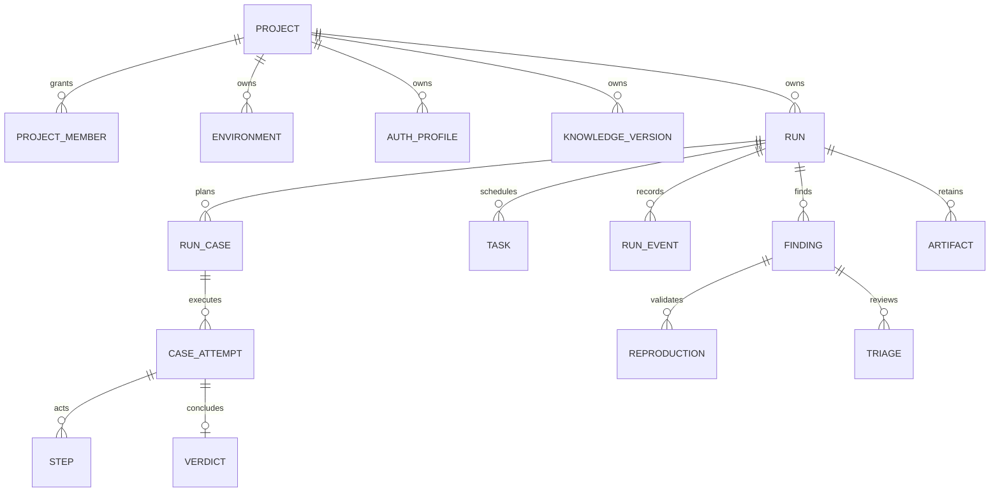

# 数据模型、接口与结果语义

版本 1.0。机读字段/枚举以 `contracts/domain.schema.json`、`openapi.json`、`tools.schema.json`、`report.schema.json` 为准；这里规定关系、事务和语义。实体 ID 为 UUID，criterion ID 为用例内稳定字符串。数据库 snake_case，DTO camelCase，时间为 UTC RFC3339，界面按用户时区显示。

## 1. 核心实体与关系



| 表/实体 | 主要数据及约束 |
| --- | --- |
| users / login_sessions | email/用户名、密码 hash、禁用状态；session 仅存随机 token hash、过期和撤销信息 |
| projects / project_members | project 状态、策略、额度；(project,user) 唯一；owner/operator/viewer；global admin 单独记录 |
| environments / environment_versions | Base URL、origins、路径、TLS、代理引用、默认认证及额度；修改产生新版本 |
| auth_profiles / auth_profile_versions | mode、固定登录配置、SecretVault refs、范围和版本；只写密钥，响应不含原值 |
| secrets / secret_versions | project、用途、ciphertext、nonce、keyVersion、禁用/撤销；与公开 API DTO 分离 |
| model_profiles / model_profile_versions | 管理员配置 endpoint、adapter、model、能力、secret ref、并发及允许 fallback；引用使用固定版本 |
| knowledge / knowledge_versions | 规则正文、类型、作者、审核/启用状态；运行引用快照，不能偷偷更新历史依据 |
| runs | creator、目标 display URL/加密原始参数引用、status、phase、contextVersion、版本快照、终止原因和报告版本 |
| run_budgets / budget_reservations | limits、used、reserved、用量来源；预约/核销有唯一 request ID，防重复计费/计数 |
| jobs / task_leases | run、role、case/目标、status、worker、leaseUntil、fencingToken、attempt、uniqueKey、结果引用 |
| run_cases | 本次计划及不可变 criteria、预期来源、outline、计划上下文版本；P1 可关联 saved_case_version |
| case_attempts / verdicts | 新 context 的一次执行；每 attempt 最多一个最终 verdict；重复提交需相同 payload hash |
| steps / action_intents | 有序动作、风险、目标、snapshot、开始/结束、outcome、fencing、证据；动作先 intent 后 outcome |
| page_snapshots / controls | 页面/节点指纹、scope、版本、发现/检查状态、与步骤关联；敏感 DOM 值不存普通字段 |
| findings / reproductions | 功能/静态发现、期望实际步骤、来源、确认状态、独立复现和证据；功能确认有复现条件 |
| triage / confirmation_previews | 审查历史、reason、actor、expectedVersion、预览 hash/有效期；不能无预览执行状态变更 |
| artifacts / exports | 类型、项目/运行/步骤归属、hash、字节数、可用/降级/错误、脱敏和保留；导出是固定快照 |
| input_requests / run_messages | 具体问题、类型、状态、期限、响应 actor；输入事件不直接变为任意工具执行 |
| audit_log | actor/action/object/version、结果、时间、脱敏摘要；删除/撤销/审批也有记录 |

P1 增加 saved_cases/versions、schedules/occurrences、locator_caches 和 API keys。API key 存 hash，有项目、scope、期限与撤销；不是全局管理员钥匙。

## 2. 数据库不可省略的规则

1. 所有项目数据有 project_id，子资源以复合 FK 校验项目和父 ID；资源查询同时校验成员资格。
2. run_case、criterion 和配置快照一旦进入执行不可就地修改。补充范围建立新 contextVersion，保留既有记录；执行中的原 criteria 不被消息降级。
3. jobs.unique_key、模型 request_id、action_id、verdict attempt ID、schedule occurrence 均唯一，重复提交幂等。
4. run_event 的 `(run_id,seq)` 唯一且严格递增；同事务写结果与关联事件，再通知。
5. terminal status 不允许被旧 Worker 改回 running。除显式新运行/新 attempt，不复用终态执行记录。
6. 人工审查和敏感修改采用 version 条件更新，冲突返回 VERSION_CONFLICT；不能 last-write-wins 抹掉前一人的操作。
7. findings.functional→confirmed 必须有独立、有效、同 criteria 的 reproduced 结果及证据；静态发现单独按截图/规则审查。
8. 同一逻辑用例的历史 verdict 全部保留，报告只选择最终有效结果；失效 fencing 的结果不能参与统计。
9. 报告/证据保留期限到期删除前检查运行、导出、人工保留和引用；GC 不按未验证的模型建议删除数据。
10. 原始秘密、敏感 URL query 和认证状态与普通事件表分离；worker scratch 不能作为持久唯一副本。

关键索引：runs(project_id,created_at,id)、jobs(status,available_at,lease_until)、run_events(run_id,seq)、run_cases(run_id,id)、case_attempts(case_id,attempt_no)、artifacts(run_id,step_id)、findings(run_id,fingerprint)、project_members(user_id,project_id)。事件及二进制材料应控制容量，不能把巨大截图塞进 run 行。

## 3. 结果及统计

| 概念 | 定义 |
| --- | --- |
| passed | 所有本次固定 criterion 有有效通过证据，没有未知关键条件 |
| issue_found | 至少一个可信 criterion 不满足；疑似问题另进入 Finding，不自动等于已确认 Bug |
| blocked | 认证、网络、数据、能力、范围或运行条件阻止验证 |
| inconclusive | 已观察/尝试但证据或预期不足，或动作结果不明 |
| not_run | 本次计划存在但未开始；只是报告投影，不是伪造的 verdict |
| suspected | 待独立复现或缺少足够业务预期的功能发现 |
| confirmed | 独立复现满足确认约束；仍需人工审查，不代表已经提交外部 Bug 系统 |
| unconfirmed | 未能重现，不自动证明问题不存在 |

统计公式必须使用唯一计划用例和最终有效结果：

```text
planned = passed + issueFound + blocked + inconclusive + notRun
attempted = passed + issueFound + blocked + inconclusive
evaluated = passed + issueFound
passRate = passed / evaluated               # evaluated=0 时为 null
attemptRate = attempted / planned           # planned=0 时为 null
```

UI 使用“通过”“已判定”“已尝试”三个不同名称。控件覆盖是本次发现的 in-scope 控件比例，不是整个站点的全量覆盖。verdictCount/agentCount 是记录数量，不能直接当成已验证用例数或同时运行数。

当取消/超限/失联发生时，用例保留真实状态，terminationReason 与 coverageGaps 解释缺口。finalizer 由数据库计算 summary，并与 report.schema 语义校验；模型写出的数字不得覆盖计算值。

## 4. 公共 API 约定

基址 `/api/v1`；OpenAPI 3.1；JSON UTF-8。cookie session 认证与 CSRF/Origin 校验；P1 API key 用 Bearer 且独立 scope。project 级资源 ID 不足以获得权限。

创建运行支持 `Idempotency-Key`，保存 actor/project/route/bodyHash 24 小时；同 key 同体返回原结果，不创建第二次运行；不同 body 返回 409。普通更新和人工审查使用 expectedVersion。数组以 `{items,nextCursor}` 返回，默认 20、最多 100。

所有错误返回 `{code,message,requestId,details?}`，details 不含堆栈、密钥、浏览器 cookie 或原始 prompt。可恢复错误说明具体下一步。

### 4.1 P0 公共接口

| 接口 | 用途/权限 |
| --- | --- |
| POST /auth/login；POST /auth/logout；GET /auth/me | 账号 session；登录限速，退出撤销 session |
| GET/POST /users；PATCH /users/{userId} | admin 管理账号、禁用与密码重置；请求正文不写日志 |
| GET/POST /projects；GET/PATCH /projects/{projectId} | 列表、创建、详情、归档与默认模型；创建由 admin，查询按成员资格 |
| GET/PUT /projects/{projectId}/members | 成员和角色；owner/admin；至少保留一个 owner |
| GET/POST /projects/{projectId}/environments | 环境元数据及创建；owner/admin；密钥不在该 DTO |
| GET/PATCH /environments/{environmentId} | 环境详情与新版本；目标 origin/TLS/代理政策校验 |
| GET/POST /projects/{projectId}/auth-profiles | 认证名称/模式及创建；write-only 材料；仅 owner/admin 配置 |
| PATCH /auth-profiles/{authProfileId} | 更新元数据/替换秘密，保留运行快照，显式撤销另记录 |
| GET/POST /projects/{projectId}/knowledge | 知识列表和添加版本；owner/operator 可提文本，规则批准由 owner |
| PATCH /knowledge/{knowledgeId} | 修改产生新版本；批准由 owner，保持运行中的旧快照 |
| GET/POST /model-profiles；GET/PATCH /model-profiles/{modelProfileId}；POST /model-profiles/{modelProfileId}/probe | 模型管理；写/探测由 admin；列表只显示获准 descriptor |
| GET/POST /runs；GET /runs/{runId} | 按项目列运行、仅 URL 发起、状态与 effective config |
| POST /runs/{runId}/cancel | operator/owner；重复取消幂等；停止所有子任务派发 |
| POST /runs/{runId}/messages | 补充说明；持久化并推进上下文版本，不直接执行任意指令 |
| GET /runs/{runId}/messages | 读取运行消息（分页）；项目成员可读（viewer 可读），非成员返回 404 不泄露存在性 |
| POST /runs/{runId}/inputs/{inputId}/respond | 回应具体 InputRequest；验证当前状态、权限和范围 |
| GET /runs/{runId}/events | SSE；按 Last-Event-ID 恢复，project viewer 可读 |
| GET /runs/{runId}/cases；GET /cases/{caseId} | 固定计划、最终结果与历次尝试 |
| GET /cases/{caseId}/attempts；GET /tasks/{taskId}/steps；GET /steps/{stepId} | 具体尝试与步骤/证据，不要求 UI 从全量 SSE 自行拼历史 |
| GET /runs/{runId}/event-history | 以 afterSeq/limit 分页读取历史，仍执行项目鉴权 |
| GET /runs/{runId}/tasks | 任务角色、状态、耗时、预算和简短摘要 |
| GET /runs/{runId}/findings；GET /findings/{findingId} | 问题、复现与审查资料 |
| POST /findings/{findingId}/triage-preview | 生成具体状态变更预览、expectedVersion、短期 confirmation token |
| POST /findings/{findingId}/triage | 绑定同 actor/内容/version 的人确认；写审查与审计 |
| GET /runs/{runId}/report | 报告快照，非终态含 partial 标记 |
| POST /runs/{runId}/exports；GET /exports/{exportId} | 固定快照导出 JSON/MD/ZIP；任务化生成、权限下载 |
| GET /artifacts/{artifactId}/content | 授权流式材料；参数不是文件路径；支持合适 Range/Content-Disposition |
| GET /artifacts/{artifactId} | 材料元数据、归属、脱敏及缺失状态 |
| GET /health/live；GET /health/ready | 存活/就绪；公开只给基本状态，不披露内部地址和秘密 |

表列的每个公共操作都在 openapi.json 中定义输入、输出和错误。前端生成 client 时排除 Internal tag。

### 4.2 P1 接口边界

P1 增加用例库版本、回归运行、schedule、CLI key、缓存和修复建议。其语义在 SRS/开发任务定义，不能在 P0 使用只有标题没有真实实现的 API 声称交付。P1 新 endpoint 须更新 OpenAPI、样例与校验，并维持 P0 兼容。

本轮已将 docs/06-web-regression-and-scheduling.md §3 的 P1 API 增量并入契约生成器（`docs/build_contracts.py`），并跑 `contracts:check` 通过：

| 接口 | 用途/权限 |
| --- | --- |
| GET/POST /projects/{projectId}/saved-cases | 用例库列表与创建（document 或 sourceRunCaseId 二选一）；项目成员可读，owner/operator 可建 |
| GET /saved-cases/{caseId}/versions | 不可变版本列表（document/hash/reviewStatus/作者/时间）；项目成员可读 |
| POST /saved-cases/{caseId}/versions | 新建 draft 版本（expectedVersion+document），不覆盖 approved；owner/operator |
| POST /saved-case-versions/{versionId}/review-preview | 显示 criteria/动作/风险差异并发放短期确认 token；owner |
| POST /saved-case-versions/{versionId}/review | 用确认 token 批准或拒绝；owner |
| POST /regression-runs | 按 caseVersionIds 发起回归运行（同一 Run DTO，跳过自主探索）；operator/owner |
| GET/POST /projects/{projectId}/schedules | 定时配置列表与创建（cron/timezone/runTemplate/overlapPolicy/missedPolicy/enabled）；owner |
| PATCH /schedules/{scheduleId} | 更新定时配置（expectedVersion），不影响已创建运行快照；owner |
| POST /schedules/{scheduleId}/run-now | 立即触发一次独立 run，受重叠/额度政策约束；operator/owner |
| GET/POST /projects/{projectId}/api-keys；POST /api-keys/{keyId}/revoke | CLI/CI key 管理；owner/operator 获得不超过自身权限的 scope，明文 token 只在创建时返回一次 |
| GET /runs/{runId}/cache-stats | 命中/未命中/失效、解析方式、节省的模型调用与耗时；项目成员可读 |
| GET/POST /saved-cases/{caseId}/repair-proposals | 失败修复建议（diff/验证记录/提议版本），不自动发布新预期；owner/operator |

P0 既有 61 个操作未改动；新增 17 个 P1 操作，总操作数 78。字段来源均为 docs/06 §3；分页/权限/状态枚举的默认判断见交付报告，需要裁决的点已标注。


## 5. Worker 内部协议

`/internal/v1` 不由公共入口转发，使用 Worker service identity + 短期 lease token；进一步限定 task/run/project、fencing 和 purpose。不能接受公共用户 cookie 作为内部服务权限。

| 接口 | 行为 |
| --- | --- |
| POST /leases/claim | 原子领取满足资源能力的任务，返回 lease/fencing/config refs；无任务返回 204 |
| POST /tasks/{taskId}/heartbeat | 当前租约续期，并返回取消/上下文变更信号 |
| POST /tasks/{taskId}/complete | 校验当前 fencing 和任务类型，事务写结果和事件 |
| POST /actions/reserve | 校验策略、上下文、目标、角色和 budget；返回 actionId 或稳定拒绝原因 |
| POST /actions/{actionId}/result | 幂等提交 outcome；重复 hash 不同/过期 lease 不覆盖有效结果 |
| POST /model/complete | 规范化请求、脱敏、预算预约、provider 调用与用量核销；返回结构化结果 |
| POST /auth/resolve | 对获准任务提供指定认证材料；原值仅内部传输/内存使用，不写普通响应日志 |
| POST /artifacts | 按 lease 绑定归属上传，限容量、校验 checksum；不接受任意本地路径 |

精确业务输入由域契约规定，内部上传可用 multipart。内部策略拒绝必须能让任务产生 blocked/inconclusive，不能触发无限“换一个工具试”。内部协议随 Worker 镜像同版本交付，不承诺第三方接入。

## 6. SSE 协议

事件 envelope：`schemaVersion,id,runId,seq,type,at,payload`；type 的固定集合见 schema。建议事件：run.updated、phase.changed、task.updated、case.created、case.result、finding.updated、step.recorded、budget.updated、input.requested、input.resolved、artifact.updated、report.ready、run.finished。

payload 为各 type 对应资源摘要；UI 从这些摘要更新状态，并按需获取完整资源。body 不传图片 base64、密码、Cookie 或巨大 network body。客户端按 seq 去重，重连带 Last-Event-ID；连接断开不取消运行。每 15 秒发送无业务含义的 heartbeat comment，代理禁用该连接缓冲。

事件数量过大时分页历史和虚拟列表；不可丢失最终 verdict/取消/报告事件而仅依赖 UI 恰好在线。

## 7. 稳定错误和原因码

| Code | HTTP / 运行语义 |
| --- | --- |
| UNAUTHENTICATED | 401 |
| FORBIDDEN | 403；成员存在但角色不足 |
| NOT_FOUND | 404；跨项目 ID 不泄露存在性 |
| VALIDATION_ERROR / TARGET_NOT_ALLOWED | 422 |
| MODEL_NOT_CONFIGURED / PROJECT_ARCHIVED | 409；派发前失败 |
| IDEMPOTENCY_CONFLICT / VERSION_CONFLICT | 409 |
| EVENTS_EXPIRED | 410；重新取得快照 |
| RATE_LIMITED | 429，Retry-After |
| BROWSER_UNAVAILABLE / SERVICE_UNAVAILABLE | 503 |
| ARTIFACT_TOO_LARGE | 413 |
| LEASE_EXPIRED / ACTION_OUTCOME_UNKNOWN | 内部 409；不自动重放动作 |
| AUTH_REQUIRED / AUTH_FAILED / CAPTCHA_REQUIRED | InputRequest 或 blocked reason，非自动产品 Bug |
| MODEL_CAPABILITY_MISSING / MODEL_TIMEOUT | 能力/模型受阻；不假造结论 |
| POLICY_DENIED / SCOPE_CHANGED | 动作不执行，记录原因 |
| BUDGET_EXCEEDED / INPUT_TIMEOUT / USER_CANCELLED | 保留部分报告和未执行范围 |

enum 不能让前端通过解析自然语言猜状态。新 provider 的原始错误须映射到既有分类，保留受控诊断而非原始敏感响应。

### 7.1 执行层原因码与本节的关系

浏览器执行层在 `ToolResult.reasonCode` 中使用下列 6 个码。契约把该字段定义为开放字符串，它们**不是** API 错误信封的 `Error.code`；对用户与 API 呈现时按下表归类，前端、报告与编排层不得绕过该映射自行解释。

| 执行层码 | 归入分类 | 处置语义 |
| --- | --- | --- |
| TARGET_NOT_FOUND | 不产生 API 错误码；用例转 blocked/inconclusive | 目标不存在或已移除：不重试同一定位，先重取 snapshot |
| TARGET_AMBIGUOUS | 同上 | 多候选：拒绝盲点，改用更稳定定位（禁止按出现顺序取第一个） |
| TARGET_HIDDEN | 同上 | 不可见/不可操作：短暂等待后标受阻，不计产品缺陷 |
| TARGET_DISABLED | 同上 | 目标被禁用：属产品观察，可由断言判定，不当作执行失败 |
| ACTION_TIMEOUT | BROWSER_UNAVAILABLE（基础设施类） | 动作超时：有限次非破坏性恢复后转 blocked |
| REPEATED_ACTION_LIMIT | POLICY_DENIED | 同动作与页面指纹重复达上限：停止该用例，防循环 |

定位失败、策略拒绝、取消、入参校验失败等其他执行层含义一律使用本节既有错误码，不再另设同义词；新增执行层码须先在此登记并说明归类。

## 8. 导出和审查

报告是 `schemaVersion=1` 的单一规范 JSON，可附 Markdown/ZIP。每个 finding 至少保留 expected/actual/reproSteps/evidenceRefs；功能 confirmed 还必须有 reproductionRef。截图/录像不可得时 artifact entry 记录 status/error，而不是写一个打不开的假链接。

triage-preview 绑定 findingId、actor、expectedVersion、disposition、reason hash、有效期 300 秒；triage 提交参数完全匹配且未使用时消费。用户在预览页确认即授权该具体动作，不二次重复询问；内容改变、版本冲突或过期需新预览。模型没有 triage 提交工具。

导出给开发 agent 的复现文案只描述目标、必要操作、实际和期望，不包含 Worker scratch/服务器绝对路径。证据通过 artifactId/离线 manifest 引用；导出包自身仍受项目数据权限和保留策略控制。
