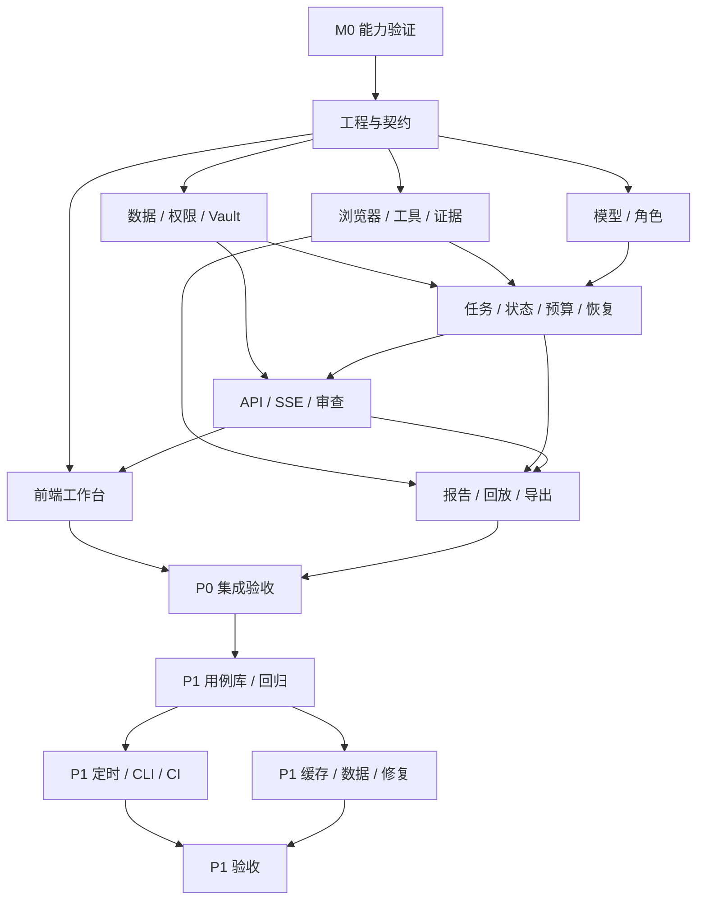

# 开发 agent 交接与任务分解

当前没有创建或派发开发 agent，没有可运行应用。用户已确认：多人内网 Linux 平台，允许外部模型 API，核心为 URL 自动冒烟。

## 1. 接手要求

阅读顺序：README→00-overview→SRS→技术设计→数据/API→机读契约→验收。观测到的 Momentic 栈不代表其全部服务端；LocalQA 使用自己的协议。契约源码是 build_contracts.py，改字段须生成并验证，不能各模块另设同名对象。

先交付一个真实垂直闭环，再扩大并发/页面。开发 UI 可使用明确标记的 fixture/mock；进入验收前接真实 API。缺少模型或 Linux 环境时完成独立工作，明确没通过的 Gate。

遵守用户工作约定：简洁中文，事实/推断/未验证分开；可逆明确工作直接完成；Ego 浏览器只操作本任务空间；数据唯一、先基线、只清理自建临时数据；Bug 提交、激活或关闭先展示具体内容/目标并取得确认。

## 2. 依赖 DAG



图示是依赖，不要求当前会话启动并行 agent。契约冻结后 T03/T04/T07 可独立开展；T07 初期用 fixture，T09 前接真实 API。T00 缺少真实模型结果不能宣称 M0/P0 完成。

## 3. 工作包

| Task | 责任/建议范围 | 依赖 | 必须交付 | 验收追踪 |
| --- | --- | --- | --- | --- |
| T00 | 兼容 Spike，docs/validation-results | 规格、获准 Linux/模型 | 版本/镜像提案、真浏览器动作/snapshot/证据、模型 JSON/工具/图片、沙箱/TLS、独立复现最小样本 | G0/G2/G3；FR-006/017/026 |
| T01 | workspace、packages/contracts、构建/CI | T00 兼容结论 | monorepo、类型/验证器、统一错误/配置、contract 校验与版本记录 | G0、跨模块类型一致 |
| T02 | packages/storage、账号/RBAC/Vault | T01 | SQL migration/repositories、用户/项目/环境/auth/knowledge/model、快照、secret 和权限；API 无原始秘密 | AC-001/004/014/016；FR-001–010 |
| T03 | packages/browser、recorders | T01 | snapshot/node、基础工具、策略、取消、console/network/截图/trace/rrweb、浏览器生命周期 | AC-005/011/014；FR-017–019/029 |
| T04 | model-gateway、agents | T01，T02 descriptor | adapter/能力/usage/脱敏、角色工具、规划/断言/复现；固定 stub 与真模型 smoke | AC-002/009/010；FR-006–008/015/025–028 |
| T05 | domain、orchestrator、worker | T02/03/04 | 状态机、PG jobs/leases/fencing、预算、幂等、phase、输入、取消/恢复、独立 contexts | AC-003/006–010；FR-011–026 |
| T06 | apps/api、内部协议、SSE/审查 | T02/05 | 全 P0 routes、RBAC/CSRF、内部身份/租约、事件恢复、确认预览、分页/错误 | AC-001/007/011–014；FR-021/031–034 |
| T07 | apps/web、client/状态投影 | T01，集成 T06 | 登录/项目、URL 发起、环境/认证/模型、工作台、case/finding/evidence、空/错误/partial/重连 | J-01–04；FR-011/030–034 |
| T08 | 报告/ArtifactStore/replay/export/GC | T03/05/06 | 统计、引用校验、授权下载/降级、JSON/MD/ZIP、保留/清理 | AC-009/011/016；FR-025/028–032 |
| T09 | test-fixture、deploy、P0 集成 | T02–08 | Compose、迁移/初始化、多用户/4 槽位、故障/备份恢复、真模型质量报告、数据回查 | G0–G4，所有 P0 AC |
| T10 | 用例/版本/DSL/回归 API/UI | T09 | 冒烟保存→审查→版本→重跑；YAML、模块、变量/升级 | FR-035–036 |
| T11 | scheduler、CLI/key、CI | T10 | cron/timezone/occurrence/overlap、独立 run、CLI 状态/导出/退出码 | FR-037–038 |
| T12 | 缓存、数据模板、修复建议 | T10 | 缓存验证/失效、授权数据/账本、清理、候选修复与人审 | FR-024/039–040 |
| T13 | 主要 Web 功能完整验收 | T11/12 | 定时/回归/CI/缓存/修复/健康指标闭环及限制报告 | 全 P1；FR-041 |

## 4. 共享文件与协作

契约、migration、全局配置和 lockfile 有单一集成负责人。agent 提出变更后由 owner 统一更新；不能先做自己的字段变体。T02 管理 migration 顺序，T05 管理状态机。

跨模块使用 ModelPort、BrowserPort、TaskStore、ArtifactStore、CredentialBroker、PolicyGate、EventStore；签名由 T01/T05 负责人冻结。不能通过直接读取私有目录/表绕过 port。

接手确认分支、目录和已有修改，保留别人工作。完成对应集成验证后继续交付，不无限扩大测试。

## 5. 首个垂直切片

初始化 admin/项目/模型→UI 输入 fixture URL→API 返回 run→DB task→Worker 真浏览器→至少一条有来源计划→动作/判定/截图→固定错误→新 context 复现→正确报告→授权导出。

该切片就带关键权限、预算和取消。之后扩大到默认 8 条和多 Worker；模块各自能启动不等于闭环完成。

## 6. 可复制任务提示

```text
执行 LocalQA 工作包 TXX。先读 README、docs/00-overview、SRS、相关技术/数据、
docs/contracts 和 docs/04-validation，确认依赖和代码现状。
在工作包模块范围实现；使用机读契约，字段变化先改 build_contracts.py 并校验。
使用本项目 fixture/唯一数据，不擅自写真实业务站点。
提供命令、环境、样本、证据、清理回查及未验证项。
mock/缺少模型只能报告对应 Gate，不宣称全能力达标。
保留既有工作，不修改无关模块，不向外发消息、Bug 或部署到未授权环境。
外部依赖缺失时继续独立部分，再明确具体缺口。
```

## 7. 完成定义

每包提供修改模块、契约/依赖版本、接口变更、运行/测试命令、实际 Gate、结果/证据、清理、限制与下一包输入。

P0 release：全部 P0 FR 有实现/AC；真浏览器、真模型、Linux Gate 有记录；协议和结果校验通过；权限、取消、预算和恢复可用；数据/运维有证据；文档符合最终实现。

本次规格不要求运行产品，也不把文档校验当产品验收。按 3 名工程师加测试/运维估算：兼容验证 1–2 周，P0 从启动累计 8–12 周，P1 再 4–8 周；按实际 M0 重估，不是交付承诺。
