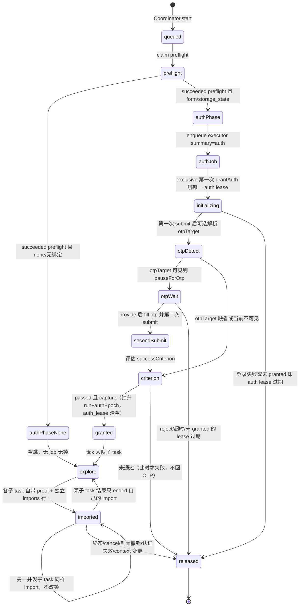

# T10-AUTH-3 最小接口方案（只读，待 Root 冻结）

日期 2026-10-06。修订 3（同一文件）。P0Passed false。不写代码、迁移、契约生成；不跑 PG/浏览器/外部模型。不增 `tools.schema` / `ToolCall`。范围仅保护凭据动作、AuthStepSource、run 级独占锁、获准状态跨 lease、OTP 票绑定。不扩 scheduler、T11、T12。010 是模块审查；锁表 / OTP 票 / run auth-state 都是 010 之后的独立迁移，Root 冻结前不实现。

Root 已确认 AUTH-2 三项为已知执行桥缺口。两个 none queued run 不是登录互斥判据。FakeBrowser DSL sentinel 不是 broker 泄漏。none 剖面不需要独占登录锁。queued / `Coordinator.start` 不是持锁点。

修订 3 只修四个可实现性问题：granted 后锁主体是 run/`authEpoch`（并发子 task 各自 import）；locator 可信边界（server 不调用 Playwright）；shared_state capture 不查锁；`BrowserSession.exportAuthState` Port 方法；以及现有 FormConfig 下「首个 submit → 可选 OTP 检测 → 二次 submit → successCriterion」顺序。修订 2 已作废的「lease released ⇒ 释 run 锁」和「一句话后续导入」继续作废。

## 不变量

1. 认证动作不是 `ToolCall`，不进入 `tools.schema.json`。模型 `generateDecision` / `validateContract('ToolCall')` / `POST /internal/v1/actions/reserve` 不能发出或接受它们。
2. 预算复用 `reserve(..., 'action', { actions: 1 })` 与现有 fencing / lease / `action_intents` / `steps` / `recordAction`。不新增 `budget_reservations.kind`。
3. 普通事件、SSE、report、`action_intents.tool_call`、`jobs.result`、`jobs.document` 禁止 secret、cookie value、`storageState` JSON、`oneTimeCode`。`reject_secret_keys` 已拒这些键名；认证密文走独立表。
4. `CredentialMaterial` 与导入后的 `ApprovedAuthState` 只在获准 lease 的进程内存里，随 session close / lease 结束丢弃。
5. 登录锁只在 exclusive_run 且真正开始 form 填写或 storage_state 导入时获取。`Coordinator.start`、queued、preflight、claim、`mode=none`、无绑定、`shared_state` 都不持锁。
6. **初始化期**锁可绑唯一 auth lease。**granted 之后**锁主体只是 `(run_id, auth_epoch)`，不再绑 `holder_task`。并发子 task 用各自当前 proof + 独立 `run_auth_state_imports` 行授权。任一子 task 结束或异常不得清其它活跃子 task 的导入行，也不得释放 run 锁。终态 / 撤销 / 认证失效仍释放。
7. 获准状态的权威副本是加密行（或 `secrets/secret_versions` 引用），Worker scratch 至多是同密文的非唯一缓存，不能当唯一副本（`docs/03-data-and-api.md` §2 第 10 条）。
8. 回归 `mode≠none` 保持 `runAuth.ts` 422，直到 Root 另冻「回归允许 AuthStepSource」。本阶段只接 smoke。
9. 不扩展 `FormConfig` 字段。OTP 二次提交仍用现有 `submitTarget`。`successCriterion` 用现有 `Criterion` + 现有 `evaluateTechnical` 能力；不支持的 kind 失败受阻。

## 0. 现状锚点（方案必须接上的真实形状）

| 项 | 现在 |
| --- | --- |
| `Task` | `id, runId, role, status, caseId, attempt, summary, elapsedSeconds`。**没有** `stage` / `kind` 字段。 |
| 入队 | `enqueue(..., stage, target, ...)` 写 `document=Task` 且 `summary=stage`；`jobs.result` 另写 `{stage, ...extra}`。`unique_key=taskKey(runId, role, \`${stage}:${target}\`, attempt, contextVersion)`。 |
| `Work.stage` | `(job.result?.stage ?? job.document.summary) as Stage`。`Stage` 无 `'auth'`。 |
| tick smoke | preflight 成功后 `change(..., 'auth')` 立刻 `change(..., 'explore')` 并 `enqueue explorer`，无认证 job。`succeeded(stage)` 读 `result.stage ?? document.summary`。 |
| `finish` | 要求 `result.stage === job.result.stage`；然后 `UPDATE jobs ... result`；`task_leases.released_at=now`；`releaseSlots`。run 继续。 |
| 并发 | `claim` 按 `budget.concurrency` / 平台槽位允许多个同 run task 同时持 lease。execute 阶段会并发生成多个 executor job。 |
| Worker | 每 task `createSession`（不传 `approvedAuthState`），类型是 `BrowserSession` Port，`finally session.close()`。scratch 是 `{scratch}/{task.id}`。 |
| `BrowserSession` Port | `executeTool` / `getSnapshot` / `resolveRegressionLocator?` / `captureScreenshot` / `cancel` / `close`。**没有** `exportAuthState` / `captureAuthState`。`getContext`/`getPage` 只在 `BrowserSessionImpl` 上，**不在 Port**；Worker 不能拿内部 `BrowserContext`。 |
| `resolveRegressionLocator` | 签名 `(page: Playwright.Page, locator, snapshot, signal?)`。必须活 Page。持久 `BrowserSnapshot.nodes` 只有 role/name/text/visible/bounds；`css` 选择器（FormConfig 常用）无法在 snapshot 上复算。 |
| `FormConfig` | `loginUrl, usernameTarget, passwordTarget, submitTarget, successCriterion, otpTarget?`。没有第二套 submit / 成功条件。 |
| 设计 153 行 | run 级独占；一个 run 登录一次；子 context 导入同一获准状态。 |
| 数据规则 10 | 认证状态与普通事件表分离；scratch 不能作为持久唯一副本。 |

---

## 1. 服务器专用认证 reservation，不污染 ToolCall

现状：`grantAction` 先 `parseContract('ToolCall')`；`ActionReservation.toolCall` 是 `ToolCall`；内部 `POST /internal/v1/actions/reserve` 走这条路径。`fill_secret` 按契约 README 不是模型工具。smoke 的 `validateBrowserTool` 只允许 observe/navigate/capture。

做法：新增 **Coordinator.grantAuth / recordAuth** 与 **RuntimeClient.grantAuth**，输入是 `AuthAction`，不是 `ToolCall`。内部另开 `POST /internal/v1/auth/actions/reserve`，body 为 `AuthActionReservation`。现有 `/actions/reserve` 保持只收 `ToolCall`；若 body 的 `name` 属于认证名，返回 `ActionPermit.permitted=false`，`reasonCode=POLICY_DENIED`。

预算：与 `grantAction` 相同，`kind='action'`，`amount={actions:1}`，同一 `proof.fencingToken` / `taskId` / `contextVersion`。计入 `maxActions` / `maxActionsPerCase`。不增加 BudgetUsed 字段。

`action_intents.tool_call` 写入 **AuthAction 脱敏对象**（无 secret / cookie / otp）。`ActionGrant.call` 类型仍是 ToolCall；认证路径用并列类型 `AuthGrant`，不要把 AuthAction 塞进 `ActionGrant.call`。

```
AuthGrant {
  id: uuid                 // action_intents.id
  step: Step               // toolName=认证名；authSource=服务器派生；regressionSource 缺省
  reservation: Reservation // 现有 {id,requestId,amount}，不要 toolCall
  action: AuthAction       // Worker 提交并经服务器核对后的动作，无 secret
}
```

`recordAuth` 复用 `recordAction` 的 outcome / fencing / result_hash / snapshot 插入。password 与 otp 的 snapshot `node.text` 在 record 前抹成空或 `•`。storage_state 的 cookie/value 不得出现在 snapshot 或 Step.summary。

Worker 内存里用 `POST /internal/v1/auth/resolve` 的 material 填表；用 `POST /internal/v1/auth/state/import` 的状态建子 context。执行函数不得把 material / ApprovedAuthState 传入 `grantAuth` / `recordAuth` / log。

---

## 2. DTO、派生关系、Task 阶段字段

不改 `ToolCall` / `ReplayStep` / `ActionReservation.toolCall`。不把 `AuthStepSource` 放进 `AuthActionReservation`。

### 2.1 Task 认证阶段（真实字段，不用 job.result 当 payload）

权威字段是现有 **`Task.summary`**（`jobs.document.summary`），不是 `jobs.result`。

| 项 | 规定 |
| --- | --- |
| `Coordinator.Stage` | 并入 `'auth'` |
| 入队 | `enqueue(client, run, 'executor', 'auth', 'login', null)` |
| 写入的 Task | `role='executor'`，`caseId=null`，`attempt=1`，**`summary='auth'`**，`status='queued'` |
| `unique_key` | `{runId}:executor:auth:login:v{contextVersion}:1` |
| `jobs.result` 入队时 | **不是**下一任务说明书。认证 job 入队 `extra={}`，不得写入 cookie / storageState / authState 密文 / nonce / 下一 stage 指令。现 helper 若仍写 `{stage:'auth'}`，只视为 `finish` 回显种子，**Worker 与 tick 不得靠它决定跑认证适配器**。 |
| `Work.stage` | **改为** `job.document.summary`（至少认证 job；推荐全部 job 不再 `result.stage ?? summary`）。 |
| Worker | `work.stage === 'auth'` 或 `work.task.summary === 'auth'` 时走认证适配器；此分支在 `requireAnonymousOrInput` **之前**，避免再次 `waitForInput(kind=auth_profile)`。 |
| `finish` | body `{ stage: 'auth', granted: true, authStateId }`。`authStateId` 为 UUID 引用。校验改为 `result.stage === job.document.summary`。无 `CriterionResult`（`caseId=null`）。须与 capture 为 **同一 proof**（§4.7）。 |
| tick | `succeeded('auth')` 读 **`j.document.summary === 'auth' && j.status==='succeeded'`**。若 auth job 在 **已 granted** 后 interrupt，以 `run_auth_states.status='granted'` 为准进入 explore，不重放登录、不释锁。成功后再 `change(..., 'explore')` 并 **独立** `enqueue(..., 'explorer', 'explore', 'entry', null)`。禁止把 auth job 的 `result` 拷进新 job。 |
| none / 无绑定 | 不入队 auth job；preflight 成功后保持现在的 auth→explore 空跳。 |

`jobs.result` 仍是 **该 job 完成回显**，可含 `granted`、`authStateId`。它不是新任务入参，也不是获准状态载体。

### 2.2 AuthStepSource（只由服务器写入 Step）

| 字段 | 类型 | 约束 |
| --- | --- | --- |
| kind | const `'auth_profile'` | 必填 |
| authProfileId | uuid | 等于 run 冻结 id |
| authProfileVersion | integer ≥1 | 等于冻结 version |
| slot | enum | `login_url` \| `username` \| `password` \| `otp` \| `submit` \| `storage_state` |
| formConfigHash | `^[0-9a-f]{64}$` | `hashPayload(冻结 FormConfig)`；storage_state 为 `hashPayload({mode, allowedOrigins})` |

禁止 `RegressionStepSource`。Step 增加可选 `authSource`。与 `regressionSource` 互斥。

对照回归：`ActionReservation.regressionSource` 由 Worker 提交、服务器对冻结 plan `hashPayload` 核对。认证 **不采用这条输入路径**。

### 2.3 AuthAction（Worker 提交的动作，无 Source、无 secret）

| name | args | 对应冻结配置 |
| --- | --- | --- |
| `navigate_auth` | `{ url }` | `url` 必须 **全等** `formConfig.loginUrl` |
| `fill_credential` | `{ target: NodeTarget, slot: username\|password\|otp }`，无 text | locator 由 Worker 按冻结字段解析（§2.5） |
| `submit_auth` | `{ target: NodeTarget }` | 两次提交都用同一个 `submitTarget` |
| `import_storage_state` | `{}` | `mode==='storage_state'` |

`fill_credential.args` 没有 `text`。otp：仅当冻结 `formConfig.otpTarget` 存在时允许 `slot=otp`，否则 `VALIDATION_ERROR`。

### 2.4 AuthActionReservation（仅 Internal）— 输入 vs 派生

```
AuthActionReservation {
  taskId: uuid
  fencingToken: integer
  contextVersion: integer
  action: AuthAction
}
```

`additionalProperties: false`。**没有** `authSource`、**没有** `regressionSource`、**没有** secret。

路径：`POST /internal/v1/auth/actions/reserve`。Headers 与现 `POST /internal/v1/auth/resolve` 相同：`X-Lease-Token`、`X-Worker-Id`、`X-Fencing-Token`、`X-Context-Version`。禁止从 DB 现行列补 fencing / context 续权。返回现有 `ActionPermit`；获准后再由 Runtime 取 `AuthGrant`。

### 2.5 AuthGrant.step.authSource 派生，以及 locator 的最小可信边界

`grantAuth` **不能**调用 `resolveRegressionLocator`。该函数需要 Playwright `Page`；`packages/orchestrator` 只有持久 `page_snapshots.document`（`BrowserSnapshot`）。snapshot 节点没有 CSSOM / 布局树，`FormConfig` 常用 `by:'css'`（如 `input[name="username"]`），现有 `evaluateTechnical` 对 css 只认 `body`。**不要承诺 server 复验 DOM 定位。**

职责切分：

| 层 | 做 | 不做 |
| --- | --- | --- |
| Worker 执行器 | `observe`（普通 ToolCall）持久化 snapshot；`session.resolveRegressionLocator(冻结 Locator)` 得到 `NodeTarget`；把 target 放进 `AuthAction` | 不传 Locator、不传 AuthStepSource、不传 secret |
| Server `grantAuth` | 派生 `AuthStepSource`；校验身份、来源、snapshot **provenance** | 不打开 Page、不跑 Playwright locator、不把 snapshot 当 DOM 解析器 |

`grantAuth` 同事务实际检查：

1. `validateLease`。`document.summary === 'auth'`，否则 `POLICY_DENIED`。
2. `authProfile(proof)`：未撤销、id/version 等于冻结值；run origins ⊆ profile origins。
3. 计算 `formConfigHash`。按 `action.name` + `args.slot` 查派生表得到 `slot`；mode 不匹配 → `VALIDATION_ERROR`，0 次浏览器发送。
4. 构造 `AuthStepSource` 写入 `Step.authSource`。Worker 提交值不参与构造。`slot` 同时标明 Worker **应当**解析的冻结字段（username→`usernameTarget` 等），这是来源绑定，不是定位复算。
5. 对带 `NodeTarget` 的动作，只验 provenance（对齐现回归 grant 已有的 snapshot 归属，不引入新 DOM 算法）：
   - `page_snapshots` 行存在且 `project_id/run_id/task_id` 属于本 job；
   - `snapshot.pageId === target.pageId`；
   - `nodes` 含该 `nodeId` 且 `frameId === (target.frameId ?? 'main')`；
   - 该 snapshot 是本 task 最近一次已 `record` 的 observe（或最近非 capture 成功 intent 的 snapshot），否则 `VERSION_CONFLICT`。
6. `navigate_auth`：`url` 全等 `loginUrl`；origin ⊆ 冻结 ∩ run allowedOrigins；`action_intents` 只存 `displayUrl`。
7. exclusive 且尚未 granted：同事务抢锁并绑 **本 auth lease**（§6）。shared_state 不插锁。

不做：用 snapshot.role/name 去「近似」css locator；不把 `evaluateTechnical` 的可见性过滤当成 grant 条件。节点是否真是冻结 locator 的命中，信任持有 Page 的执行器；server 只保证 target 来自本 lease 刚持久化的 snapshot。

若 Root 以后要更强证明，另冻独立 DTO（例如 `locatorHash=hashPayload(冻结 Locator)` 由 Worker 随 action 提交、server 与冻结字段比对）。那仍不是 DOM 复验，本阶段 **不新增** 该字段。

派生表：

| action.name | args | 冻结字段（Worker 解析） | 派生 slot | 允许的 mode |
| --- | --- | --- | --- | --- |
| navigate_auth | url === loginUrl | loginUrl | login_url | form |
| fill_credential | slot=username | usernameTarget | username | form |
| fill_credential | slot=password | passwordTarget | password | form |
| fill_credential | slot=otp | otpTarget 必有 | otp | form |
| submit_auth | — | submitTarget（首次与二次相同） | submit | form |
| import_storage_state | {} | mode+allowedOrigins | storage_state | storage_state |

### 2.6 不新增公开 HTTP DTO

`CredentialMaterial` / `AuthResolve` / `AuthProfile` / `FormConfig` / `InputRequest` 形状保持。OTP 密文不进 InputRequest。获准状态的公开 GET/SSE/report 只可出现 `authStateId`（UUID）和 `granted` 布尔。

内部新增（契约 Internal，Root 冻结后生成）：`AuthAction`、`AuthActionReservation`、`AuthStepSource`、`AuthStateCapture`、`AuthStateRef`、`AuthStateImport`。Port 方法 `exportAuthState` 在 `@localqa/browser`，不进 tools.schema。

---

## 3. form / storage_state：origin、容量、登录顺序

执行前：`authProfile(proof)` 与 `resolveAuth` 的 id/version 必须一致。`formConfigHash` 对不上 → `VALIDATION_ERROR`，0 次浏览器发送。

origin（执行时再查，不只创建时 `validateAuth`）：

- URL / storage origin ⊆ 冻结 `allowedOrigins` ∩ `run.effectiveConfig.allowedOrigins`（`URL.origin`）。
- cookie.domain 去前导 `.` 后等于某允许 origin 的 hostname（与现 `validateAuth` 相同）。
- 失败：`TARGET_NOT_ALLOWED`，不 import、不 goto。

容量（创建已有 secretInput 单字段 1e6；执行另加硬顶，数值 Root 冻结）：

| 项 | 建议上限 |
| --- | --- |
| cookies | 50 |
| origins | 30 |
| 每 origin 的 localStorage 键 | 32 |
| 单 value UTF-8 字节 | 4096 |
| storageState 字符串总长 | 65536 |

超限：`ARTIFACT_TOO_LARGE`（HTTP 413）或 `VALIDATION_ERROR`。Root 选一个，不要新 ErrorCode。

浏览器：`approvedAuthState` 只在 import 校验通过后传入。origins 注入失败必须受阻（`AUTH_FAILED`），禁止空 `catch`。cookies 只用 `addCookies`。localStorage 若必须导航，只能是已 grant 的 `navigate_auth`，失败即失败。

### 3.1 现有 FormConfig 下的顺序（不扩字段）

只用：`loginUrl`、`usernameTarget`、`passwordTarget`、`submitTarget`、`successCriterion`、可选 `otpTarget`。不新增 `otpSubmitTarget` / 第二 `successCriterion`。二次 submit 仍 grant `submit_auth`，locator 仍是 `submitTarget`。

`successCriterion` 用现有 `Criterion`。Worker 包成单条 criteria 的 `CaseDefinition`，走现有 `evaluateTechnical`。`evaluateTechnical` 已实现的：`http_status`+`generic_smoke`，`element_visible` 且 locator 为 role/test_id/text 或 `css body`。其它 kind（`semantic`/`visual`/`text_equals`/`url_matches`、非 body 的 css）结果不是 `passed` → 视为未成功，`AUTH_FAILED`。不发明新 oracle。

算法（认证适配器，非 DSL、非模型 ToolCall）：

1. `navigate_auth`
2. `fill_credential username` → `fill_credential password`
3. **第一次** `submit_auth`（`submitTarget`）
4. `observe`。**此处不跑 successCriterion。**
5. 若配置了 `otpTarget`：在当前 session 上 `resolveRegressionLocator(otpTarget)`\
   - 得到唯一可见 `NodeTarget` → `pauseForOtp` → `fill_credential otp` → **第二次** `submit_auth`（同一 `submitTarget`）→ 再 `observe`\
   - 未找到 / 不唯一 / 不可见 → **不** `pauseForOtp`，**不** `AUTH_FAILED`，进入 6（无验证码页，第一次 submit 可能已完成登录）
6. 若未配置 `otpTarget`：跳过 5
7. 现在才评估 `successCriterion`\
   - `passed` → `exportAuthState` → `POST .../auth/state/capture` → `finish` granted\
   - 否则 `AUTH_FAILED`：不 capture、不 explore；exclusive 且尚未 granted 则释锁

**禁止**：先判 `successCriterion` 失败再 `pauseForOtp`。OTP 只作为第一次 submit **之后**、成功判定 **之前** 的可选检测。

storage_state：无填表/OTP。`import_storage_state`（resolve 剖面 secret → 注入当前 session）→ `exportAuthState` → capture → finish。

---

## 4. 获准状态跨 lease：权威密文、Port 导出、scratch、origin / epoch / fencing

### 4.1 为什么必须有权威副本

Worker 每 task 新建 context，`finally close`。认证 job `finish` 释放 **task lease** 并关浏览器。explore / execute / reproduce 是不同 `jobs.id`、不同 `contextId`、不同 scratch。同 run 可按 `budget.concurrency` 并发多个子 task。设计要求同一 run 登录一次、子 context 导入同一获准状态。form/storage_state **成功当下**必须把浏览器状态写入与事件表分离的受保护存储。

### 4.2 权威存储

新表 `run_auth_states`（010 之后，RLS/GRANT 对齐 `secret_versions`；解密只走 Coordinator/leases）：

| 列 | 作用 |
| --- | --- |
| id | `authStateId` |
| project_id, run_id | **每 run 至多一行 granted**。`UNIQUE(project_id, run_id)` |
| auth_profile_id, auth_profile_version | 冻结剖面 |
| context_version | 捕获时的 run.contextVersion |
| capturing_task_id, capturing_fencing_token, capturing_worker_id | **捕获时** proof；finish 必须相同 |
| secret_id, secret_version | `purpose='run_auth_state'` |
| import_epoch | integer ≥1；与锁 `auth_epoch` 相同；撤销时 +1 |
| origin_fingerprint | `hashPayload(排序后的允许 origin 列表)` |
| status | `granted` \| `revoked` |
| captured_at, revoked_at | 时间 |
| state_fingerprint | `hashPayload` 脱敏后的结构（cookie 名/domain/path、origin 列表，**不含 value**），供同 proof 幂等 |

密文包装 JSON：

```
{
  importEpoch: number,
  originFingerprint: string,
  runId, authProfileId, authProfileVersion, contextVersion,
  state: ApprovedAuthState
}
```

GCM nonce/auth_tag 只在 `secret_versions`。`jobs.result` / events 只许出现 `authStateId`。

### 4.3 scratch 非唯一副本

- 权威：`run_auth_states` + `secret_versions`。
- 捕获 task 的 `{scratch}/{taskId}/` 允许短暂存放 **同一密文** 副本（0o700），仅该 lease 未释放前崩溃重试；明文禁止落盘。
- `finish` / `close` / lease 释放后删除该 task scratch。其它 task 不得读旧文件。
- 子 context 导入只走 import API。

### 4.4 Port：`exportAuthState`（非模型方法）

现状：Worker 持有的是 `BrowserSession` Port，没有 `exportAuthState`；`getContext()` 不在 Port 上，不能从 Worker 调 `context.storageState()`。

新增（冻结后改 `packages/browser/src/port.ts` + Playwright 实现 + FakeBrowser，**不进** `tools.schema`）：

```
interface BrowserSession {
  // 现有方法不变
  exportAuthState(options?: { signal?: AbortSignal }): Promise<ApprovedAuthState>
}
```

| | 规定 |
| --- | --- |
| 输入 | 可选 `AbortSignal`。无 URL、无 target、无 secret 参数。导出的是 **当前这个 session** 的 context。 |
| 输出 | `ApprovedAuthState`：`cookies[]`（name/value/domain/path/expires/httpOnly/secure/sameSite）、`origins[]`（origin + localStorage 名值）。形状与现 `BrowserSessionOptions.approvedAuthState` 相同。 |
| Playwright 实现 | 内部 `this.context.storageState()` 映射到上述形状。Worker 看不到 `BrowserContext`。session 已 close / signal abort → 抛错，不返回部分状态。 |
| 校验（Port 内） | session 未 close；只读本 context；不写 artifactsDir / 日志 / recorder。失败受阻，禁止空 catch。 |
| 调用方 | 仅认证适配器在 §3.1 第 7 步 `passed` 之后、`POST capture` 之前。explore 路径禁止调用。 |
| 与 grant | 不是 ToolCall，不占 `grantAuth`。导出材料只进 capture HTTP，不进 `action_intents`。 |

**FakeBrowser 可测路径**（不启 Chromium、不改产品测试夹具也可在冻结后加）：

- Fake session 内存 `storage: ApprovedAuthState`，默认空。
- `createSession({ approvedAuthState })` 深拷贝写入 `storage`。
- `exportAuthState()` 返回深拷贝；close 后拒绝。
- 认证适配器第一次 submit 成功后，Fake 可在 `executeTool(submit_auth 或 click)` 里写入 `cookies: [{ name:'sid', value:'granted', domain:'localhost', path:'/' }]`，测试断言 export 含该 cookie、capture mock 收到同一对象、close 后再 export 失败。
- import 测试：第二 session `createSession({ approvedAuthState: 导入结果 })` 后 `exportAuthState()` 与导入对象结构相等。
- 不经过 `getContext`。现有 FakeBrowser 无此方法则测例会直接失败，这是冻结后的接线证明。

### 4.5 捕获与导入路径

**捕获**（认证 job、successCriterion 已 `passed`、**同一** live session 刚 `exportAuthState`、lease 仍有效）：

`POST /internal/v1/auth/state/capture`

Headers：同 resolve。

```
AuthStateCapture {
  taskId, fencingToken, contextVersion,
  cookies, origins
}
```

服务器 **一律** 验证（shared_state 也要）：`validateLease`；`document.summary==='auth'`；fencing/worker/contextVersion 与 proof 一致；剖面未撤销；§3 容量与 origin；state 来自本请求 body（不接受 Worker 缓存的旧 export：见 §4.7）。

**锁：** 仅 `sharingPolicy==='exclusive_run'` 时检查 run 锁存在、`status=held`、`run_id` 本 run、`phase='initializing'`、`auth_lease_task_id/fencing/worker` 等于当前 proof。**shared_state 不持锁，跳过整段锁检查。** none / 无绑定禁止 capture。

通过后：加密写入；`status=granted`；`import_epoch=1`；exclusive 锁升为 `phase='granted'`，`auth_epoch=1`，**清空 auth_lease_***（此后主体只剩 run/epoch）。返回 `AuthStateRef{ authStateId, runId, importEpoch, originFingerprint, capturedAt }`，无 cookie value、无 GCM nonce。

捕获失败：`AUTH_FAILED`，不 explore；exclusive 初始化期释锁。

**导入**（后续任意子 task，`createSession` 之前）：

`POST /internal/v1/auth/state/import`

```
AuthStateImport { taskId, fencingToken, contextVersion, authStateId }
```

返回 `{ mode, state: ApprovedAuthState, expiresAt }`，`expiresAt=该 task 的 lease_until`。注入 `createSession({ approvedAuthState })` 后丢弃引用。

每 **(task_id, fencing_token)** 一行 `run_auth_state_imports(..., imported_at, ended_at)`，`UNIQUE(task_id, fencing_token)`。同 proof 重试幂等。**不同子 task 各写各的行**，互不覆盖。新 fencing 新行，仍读同一密文（epoch 未变）。

### 4.6 导入检查（无单 holder_task）

解密后、注入前：

| 检查 | 失败码 |
| --- | --- |
| 行不存在或 `run_id` ≠ 当前 job 的 run | `NOT_FOUND` |
| `status='revoked'` | `AUTH_FAILED` |
| 明文 `importEpoch` ≠ 列 `import_epoch` | `AUTH_FAILED` |
| 剖面 id/version 不符或 revoked | `AUTH_FAILED` |
| contextVersion 不符 | `SCOPE_CHANGED` |
| origin_fingerprint / cookie.domain / origin / 容量 | `SCOPE_CHANGED` / `TARGET_NOT_ALLOWED` / 容量码 |
| **exclusive**：锁 `held` 且 `phase='granted'` 且 `lock.run_id` 本 run 且 `lock.auth_epoch === import_epoch` | 否则 `AUTH_FAILED` |
| **exclusive 不**要求 `auth_lease_*` 或任何 `holder_task` 等于当前 proof | — |
| 当前 `validateLease` 失败 | `LEASE_EXPIRED` |
| **shared_state** | 无锁行；其余检查相同 |
| none / 无绑定 | 禁止 import |
| 该 `(task_id, fencing)` 行 `ended_at` 已设 | `LEASE_EXPIRED`（本 task 已结束授权；其它 task 行不受影响） |

### 4.7 capture / finish 同 proof，拒绝旧 state

- capture 与随后的 auth `finish` 必须是 **同一** `taskId + fencingToken + workerId + contextVersion`。`finish` 读 `run_auth_states.capturing_*`，不一致 → `LEASE_EXPIRED`。
- 只接受 **当前 live session 本次** `exportAuthState()` 的 body。Worker 不得把上一 lease / 上一 session 缓存的 ApprovedAuthState 再 POST。server 侧：`phase` 已是 `granted` 时，仅当 `capturing_fencing_token` 相同且 `state_fingerprint` 相同才幂等返回原 `AuthStateRef`；fingerprint 不同 → `VERSION_CONFLICT`；fencing 不同 → `LEASE_EXPIRED`。
- session 已 close 后 Port 拒绝再 export，因此 crash-restart 必须重新登录（未 granted）或走 import（已 granted 的其它 task）。认证 job 自身在 close 之后不能再 capture。
- 不接受「先 export、放 lease、换 fencing 再 capture」。

### 4.8 撤销与子 task 结束

撤销（`status=revoked`，`import_epoch+=1`，exclusive 锁 `auth_epoch+=1` 并 `released`）：run 终态、user_cancel、剖面 revoked、登录失败（未 granted）、contextVersion 增加、认证失效。之后任何 import 失败。已授予的子 task 内存状态随各自 session close 丢弃；不能用旧 epoch 再 import。

**子 task 正常 `finish` / `releaseSlots`：** 只把 **该** `(task_id, fencing)` 的 import 行 `ended_at=now`。不改锁，不改 epoch，不删其它 import 行，不 revoke `run_auth_states`。

**子 task `recoverExpired`（已 granted）：** 同样只结束该 import 行。run 锁保持。其它并发 executor 继续 import/持有。

**认证 job `recoverExpired` 且尚未 granted：** 释锁，作废 OTP 票，`AUTH_FAILED`。

**认证 job `recoverExpired` 且已经 granted（capture 已写、finish 未到）：** 不释锁；tick 按 granted 行进 explore。

---

## 5. auth / OTP：pauseForOtp、票绑定、单消费

现 `waitForInput` 会把 job 设为 waiting、**释放 lease 和槽位**。OTP 必须保留登录 context（设计 §7：最长 300s，最多一半槽位）。OTP **不得**调用现 `waitForInput`。

### 5.1 pauseForOtp

只允许出现在 §3.1 第 5 步（第一次 submit 之后、successCriterion 之前，且 `otpTarget` 当前可解析）。

- 插入 `InputRequest`：`kind='one_time_code'`，`expiresAt=now+300s`，prompt 不含 secret。
- job **保持 running**，lease 保持，heartbeat 继续。
- 不 `releaseSlots`。running 等待计入 activeSeconds。
- 并发：`one_time_code` pending 且 job running 的数量 ≥ `floor(platformSlots/2)`（默认 4→2）→ `RATE_LIMITED`，不建 input、不建票。
- exclusive 仍处于 `phase='initializing'`，auth lease 绑定保持。
- Worker 不 return、不 close session。

### 5.2 respond 按 kind（改 `apps/api/src/routes/runs.ts`）

| Input.kind | provide | approve | reject / 过期 |
| --- | --- | --- | --- |
| `one_time_code` | 必填 `oneTimeCode`；禁止 `authProfileId`/`allowedOrigins`/`text`。加密写入一次性票，**不**写进 InputRequest/SSE。status=resolved。job 仍 running | `VALIDATION_ERROR` | status=rejected/expired；`AUTH_FAILED` 或 `INPUT_TIMEOUT`；关 session；**尚未 granted 则释锁**；作废未消费票 |
| `auth_profile` | 若仍收到：`VALIDATION_ERROR` | `VALIDATION_ERROR` | 受阻，不匿名继续 |
| `clarification` | 保持 | 保持 | 保持 |

### 5.3 OTP 票

`auth_otp_tickets` 绑定：`project_id, run_id, input_id UNIQUE, task_id, worker_id, fencing_token, context_version, auth_profile_id, auth_profile_version, ciphertext/nonce/auth_tag/key_version, expires_at, consumed_at, consume_task_id, consume_fencing_token`。`purpose='auth_otp'`。明文只含 oneTimeCode。

消费在 `fill_credential slot=otp` 的 `grantAuth` 同事务：

`UPDATE ... SET consumed_at=now, consume_task_id=$task, consume_fencing_token=$fencing WHERE ... consumed_at IS NULL AND expires_at>now AND project/run/task/worker/fencing/context/authVersion 全等 RETURNING ...`

0 行 → 不解密，`AUTH_FAILED` 或 `LEASE_EXPIRED`。旧 lease / 旧 input / 新 fencing 不能消费。respond 时 pending input 必须仍属于 **当前 running 的同一 task+fencing**。

OTP 过期：tick 扫 **running** job 上 pending `one_time_code`。过期则 interrupt；仅未 granted 时释锁。

---

## 6. exclusive 锁：初始化绑 auth lease，granted 后只绑 run/authEpoch

表：`auth_profile_run_locks`。

| 列 | 含义 |
| --- | --- |
| project_id, auth_profile_id | 跨 run 互斥键。按剖面 **id**，不按 version |
| run_id | 持有该锁的 run |
| context_version | 持锁时的 run.contextVersion |
| status | `held` \| `released` |
| phase | `initializing` \| `granted` |
| auth_lease_task_id, auth_lease_fencing_token, auth_lease_worker_id, auth_lease_until | **仅 initializing** 非空，等于唯一认证 job proof |
| auth_epoch | initializing=0；capture 成功=与 `import_epoch` 相同的正整数；撤销 +1 |
| held_at, released_at, release_reason | 见下 |

部分唯一：

- `(project_id, auth_profile_id) WHERE status='held'`
- `(project_id, run_id) WHERE status='held'`

`shared_state` / `none` / 无绑定：**不插行**。

修订 2 的 `hold_kind=task|run_handoff` 以及「claim 时把 holder 续到某个子 task」**作废**。那会让第二个同 run 并发子 task 的 import 因 holder 不匹配被 `LEASE_EXPIRED` 拒绝，也与 `budget.concurrency` 冲突。

### 6.1 持有起点

| 事件 | 锁 |
| --- | --- |
| `start` / queued / claim / preflight | 否 |
| `mode=none` 或 profile=null | 否 |
| `shared_state` | 否（仍 capture/import） |
| exclusive 第一次 `grantAuth`（navigate_auth 或 import_storage_state） | **是**。`phase='initializing'`，auth_lease=*当前认证 job proof*，`auth_epoch=0`。冲突：`RATE_LIMITED`，禁止匿名 createSession |
| OTP pause | 保持 initializing + 同一 auth lease |
| capture 成功 | **升格**：`phase='granted'`，`auth_epoch=import_epoch`，**auth_lease_* 置空**。主体变为 run+epoch |
| 同 run 后续任意子 task claim / import | 不改锁行；不抢 holder |
| 子 task finish / 过期 | 不改锁行 |

第二 run 可 queued，不得并行登录。

### 6.2 释放

`release_reason`：`run_terminal` \| `user_cancel` \| `auth_failed` \| `auth_invalid` \| `otp_timeout` \| `abnormal_lease_expiry` \| `profile_revoked` \| `scope_changed`。

| 事件 | 释放 run 锁？ |
| --- | --- |
| run 终态 / cancel 到终态 | 是 |
| 登录失败 / successCriterion 未通过 / capture 失败（未 granted） | 是 |
| OTP reject/过期且尚未 granted | 是 |
| 剖面 revoked / contextVersion 变化 / 认证失效 | 是 |
| 认证 job 成功 capture+finish | **否** |
| 认证 job lease 释放（已 granted） | **否** |
| 任一探索/执行子 task finish | **否**；只结束该 import 行 |
| 任一探索/执行子 task `recoverExpired` | **否** |
| 认证 job `recoverExpired` 且尚未 granted | **是** |
| OTP 等待中（lease 有效） | 否 |
| 另一 job queued | 否 |

`tick` / `recoverExpired` **禁止**用「某个 task lease released」作为释 run 锁条件。granted 之后看 run 终态 / 撤销 / epoch，不看子 task fencing。

### 6.3 与修订 2 的差异

作废：`hold_kind`、claim 续持到单一 `holder_task`、import 要求 `holder_task_id==当前 proof`、explore finish 再交接回 `run_handoff`。那些实现会把并发子 task 卡死。

---

## 7. 状态图



Job：认证 `queued → running → succeeded`；OTP 保持 running。锁：`held(initializing+authLease) → held(granted+run/epoch) → released`。获准状态：无行 → `granted` → `revoked`。

---

## 8. 状态与错误（复用现有 ErrorCode，不新 HTTP 码）

| 场景 | code | 说明 |
| --- | --- | --- |
| 模型/普通 grant 使用认证名 | POLICY_DENIED | `/actions/reserve` 与 `grantAction` |
| 非 auth stage 调 grantAuth / capture / exportAuthState 用于非认证 | POLICY_DENIED | Task.summary 不是 `auth` |
| AuthStepSource 派生失败 / url≠loginUrl / snapshot provenance 失败 | VALIDATION_ERROR / NOT_FOUND / VERSION_CONFLICT | 422 / 对应现码 |
| origin/cookie 越界 | TARGET_NOT_ALLOWED | 422 |
| storage 超容量 | ARTIFACT_TOO_LARGE 或 VALIDATION_ERROR | Root 二选一 |
| 锁冲突 / OTP 槽满 | RATE_LIMITED | 429 |
| 登录/OTP/注入/capture/import 失败 | AUTH_FAILED | finish 用 `setup_failure` + reasonCode=`AUTH_FAILED` |
| OTP 超时 | INPUT_TIMEOUT | 已有 |
| 当前 proof 无效；OTP 旧 fencing；capture/finish proof 不一致；已 ended 的 import 再取 | LEASE_EXPIRED | **不再**用于「不是锁的唯一 holder_task」 |
| 同 lease 重复 capture 但 fingerprint 不同 | VERSION_CONFLICT | 已有 |
| contextVersion / origin fingerprint 变化 | SCOPE_CHANGED | 已有 |
| 动作超预算 | BUDGET_EXCEEDED | 保持 |
| OTP approve / 带 authProfileId | VALIDATION_ERROR | 禁止无限授权 |
| 回归 form/storage_state | VALIDATION_ERROR | 现 runAuth 422 文案保留 |

Run.phase：preflight 成功且冻结 mode 为 form/storage_state → **停在 `auth`**，入队认证 job；granted 后再 explore。none 保持空跳。

---

## 9. 改动位置（冻结后才改）

| 位置 | 改动 |
| --- | --- |
| `docs/build_contracts.py` | AuthStepSource、AuthAction、AuthActionReservation、AuthStateCapture、AuthStateRef、AuthStateImport；Step.authSource；**不改 ToolCall / tools.schema / FormConfig** |
| 新 migration（010 之后） | `auth_profile_run_locks`（phase + auth_epoch + 仅初始化的 auth_lease_*）、`auth_otp_tickets`、`run_auth_states`、`run_auth_state_imports`（含 `ended_at`） |
| `packages/orchestrator/src/core.ts` | Stage `auth`；Work.stage←document.summary；tick 停在 auth；grantAuth 只做 provenance；pauseForOtp；锁 initialize/升格/释放；finish 同 proof；capture/import |
| `packages/orchestrator/src/runtime.ts` | grantAuth、pauseForOtp、captureAuthState、importAuthState |
| `packages/storage/src/leases.ts` | recoverExpired：未 granted 的 auth lease 过期释锁；已 granted 的任意子 task 过期不释锁 |
| `packages/browser/src/port.ts` | **新增** `exportAuthState`；不把 `getContext`/`getPage` 升到 Port |
| `packages/browser/src/session.ts` | 实现 export；注入失败受阻 |
| FakeBrowser 测试夹具 | 内存 storage 往返，见 §4.4 |
| `apps/worker/src/index.ts` | auth 适配器按 §3.1；export→capture→finish 同 proof；子 task import；OTP 不 waitForInput |
| `apps/api/src/routes/internal.ts` | reserve / capture / import；shared_state capture 不查锁 |
| `apps/api/src/routes/runs.ts` | OTP respond |
| `apps/api/src/runAuth.ts` | 回归非 none 仍 422 |
| `packages/domain` | 不把 fill/submit 加进 validateBrowserTool |

不改：scheduler、web 主路径、model-gateway、contracts ToolCall、worker-entry、FormConfig 字段。

内部路径：

| 方法 | 路径 | 入 | 出 |
| --- | --- | --- | --- |
| POST | `/internal/v1/auth/resolve` | AuthResolve + headers | CredentialMaterial |
| POST | `/internal/v1/auth/actions/reserve` | AuthActionReservation | ActionPermit |
| POST | `/internal/v1/auth/state/capture` | AuthStateCapture | AuthStateRef |
| POST | `/internal/v1/auth/state/import` | AuthStateImport | 内存 ApprovedAuthState + expiresAt |

---

## 10. Worker 对照

| 冻结 mode | resolveAuth | 锁 | createSession | 跨 task 状态 | waitForInput |
| --- | --- | --- | --- | --- | --- |
| none / 无绑定 | 不调用 | 否 | 无 approvedAuthState | 无行 | 否 |
| form exclusive | 认证 job 填表前 | 初始化绑 auth lease；capture 后只 run+epoch | 认证 job 无 state；后续各子 task 各自 import | `run_auth_states` | 仅 otpTarget **当前可见** 时 pauseForOtp |
| form shared_state | 是 | 否；capture 仍验 proof/来源/容量/origin | 同上 | 仍写 run 级副本 | 同上 |
| storage_state exclusive | import_storage_state 前 | 同 form exclusive | 注入后 export+capture | 子 task 只 import run 副本 | 否 |

替换 `requireAnonymousOrInput` 对 form/storage_state 的占位等待。

---

## 11. Root 冻结清单

1. AuthAction 四名字与 slot；Reservation **不含** AuthStepSource。
2. Task 阶段 = `Task.summary==='auth'`；不用 `job.result` 当下一任务 payload。
3. granted 后锁主体 `(run_id, auth_epoch)`；并发子 task 独立 imports；子 task 结束只 ended 自己的行。
4. locator：Worker 解析 + server snapshot provenance；server 不调用 `resolveRegressionLocator`。
5. capture：exclusive 才查 run 锁；shared_state 不查锁但仍验 proof/来源/容量/origin。
6. Port `exportAuthState` 的入出与 FakeBrowser 往返；capture/finish 同 proof，拒旧 state。
7. 登录顺序：首次 submit → 可选 OTP 检测/二次 submit → 最后 successCriterion；失败后不再请求 OTP。不扩 FormConfig。
8. 容量码、锁冲突 RATE_LIMITED、smoke-only、OTP 300s 与半槽、none/queued 永不持锁。

冻结前禁止实现和全量 migrate。必测（冻结后）：none 无锁无 decrypt；exclusive 第二 run grantAuth 429；已 granted 后两个并发子 task 都能 import；结束其中一个不影响另一个 import；shared_state capture 无锁行仍 2xx 或明确校验失败；FakeBrowser export/import 往返；successCriterion 失败路径 0 次 OTP input；otpTarget 可见才 pauseForOtp；未 granted 的 auth lease 过期释锁；已 granted 的子 task 过期不释 run 锁。
